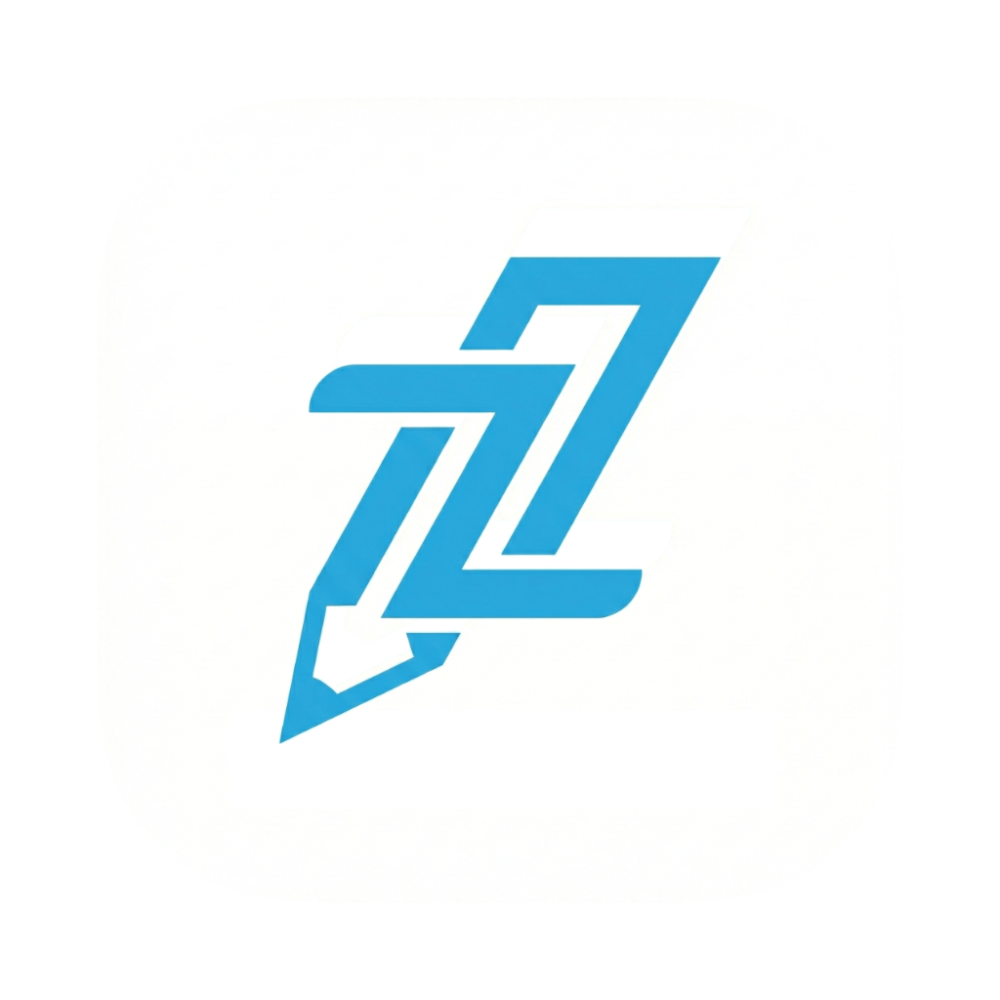
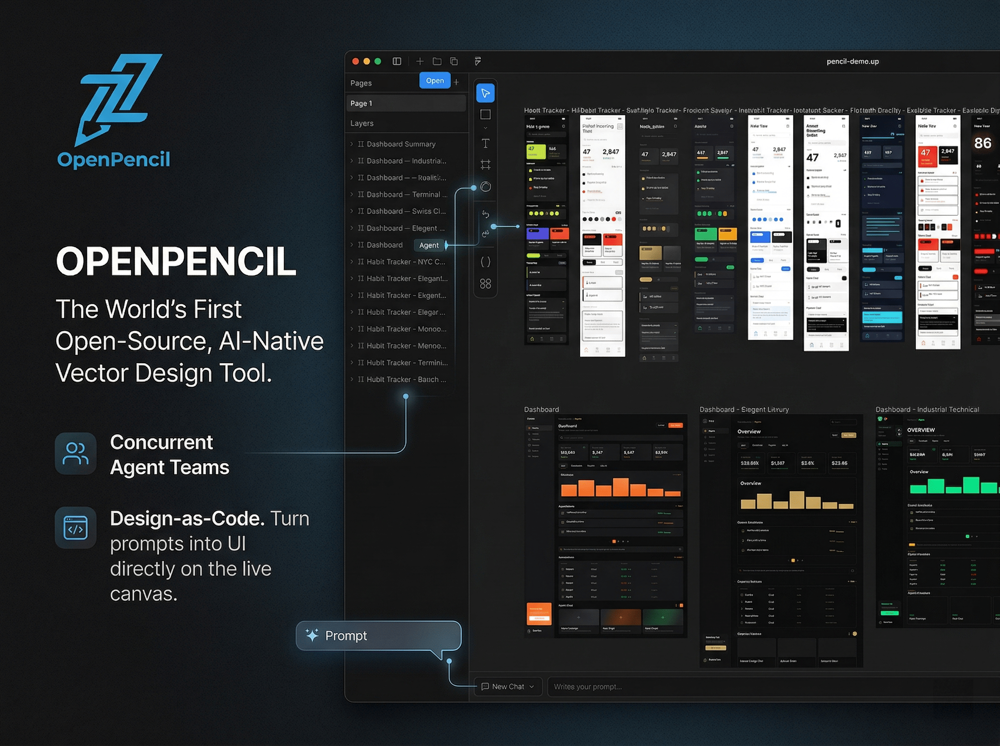
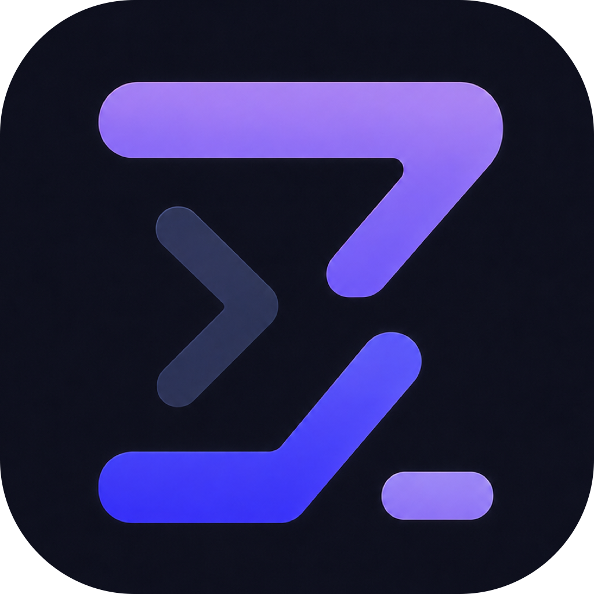
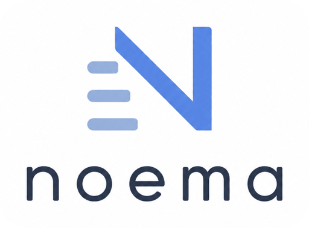

<p align="center">
  
</p>

<h1 align="center">OpenPencil</h1>

<p align="center">
  <strong>La primera herramienta de diseño vectorial de código abierto nativa de IA del mundo.</strong><br />
  <sub>Equipos de Agentes Concurrentes &bull; Diseño como Código &bull; Servidor MCP Integrado &bull; Inteligencia Multimodelo</sub>
</p>

<p align="center">
  <a href="./README.md"><b>English</b></a> · <a href="./README.zh.md">简体中文</a> · <a href="./README.zh-TW.md">繁體中文</a> · <a href="./README.ja.md">日本語</a> · <a href="./README.ko.md">한국어</a> · <a href="./README.fr.md">Français</a> · <a href="./README.es.md">Español</a> · <a href="./README.de.md">Deutsch</a> · <a href="./README.pt.md">Português</a> · <a href="./README.ru.md">Русский</a> · <a href="./README.hi.md">हिन्दी</a> · <a href="./README.tr.md">Türkçe</a> · <a href="./README.th.md">ไทย</a> · <a href="./README.vi.md">Tiếng Việt</a> · <a href="./README.id.md">Bahasa Indonesia</a>
</p>

<p align="center">
  <a href="https://github.com/ZSeven-W/openpencil/stargazers"></a>
  <a href="https://github.com/ZSeven-W/openpencil/blob/main/LICENSE"></a>
  <a href="https://github.com/ZSeven-W/openpencil/actions/workflows/rust-check.yml"></a>
  <a href="https://discord.gg/h9Fmyy6pVh"></a>
</p>

<p align="center">
  <a href="https://trendshift.io/repositories/24088?utm_source=repository-badge&amp;utm_medium=badge&amp;utm_campaign=badge-repository-24088" target="_blank" rel="noopener noreferrer"></a>
</p>

<br />

<p align="center">
  <a href="https://oss.ioa.tech/zseven/openpencil/a46e24733239ce24de36702342201033.mp4">
    
  </a>
</p>
<p align="center"><sub>Haz clic en la imagen para ver el video de demostración</sub></p>

## Por Qué OpenPencil

<table>
<tr>
<td width="50%">

### 🎨 Prompt → Lienzo

Describe cualquier interfaz en lenguaje natural. Obsérvala aparecer en el lienzo infinito en tiempo real con animación de transmisión. Modifica diseños existentes seleccionando elementos y chateando.

</td>
<td width="50%">

### 🤖 Equipos de Agentes Concurrentes

El orquestador descompone páginas complejas en subtareas espaciales. Múltiples agentes de IA trabajan en diferentes secciones simultáneamente — hero, características, footer — todos transmitiendo en paralelo.

</td>
</tr>
<tr>
<td width="50%">

### 🧠 Inteligencia Multimodelo

Se adapta automáticamente a las capacidades de cada modelo. Claude recibe prompts completos con pensamiento; GPT-4o/Gemini desactivan el pensamiento; modelos más pequeños (MiniMax, Qwen, Llama) reciben prompts simplificados para una salida confiable.

</td>
<td width="50%">

### 🔌 Servidor MCP

Instalación con un clic en Claude Code, Codex, OpenCode, Kiro o Copilot CLIs. Diseña desde tu terminal — lee, crea y modifica archivos `.op` a través de cualquier agente compatible con MCP.

</td>
</tr>
<tr>
<td width="50%">

### 🎨 Guías de estilo

Biblioteca de guías de estilo integrada con coincidencia difusa por etiquetas. Aplica estilos visuales (glassmorphism, brutalist, retro, etc.) a diseños generados por IA. Herramientas MCP para el acceso de agentes externos.

</td>
<td width="50%">

### 📦 Diseño como Código

Los archivos `.op` son JSON — legibles por humanos, compatibles con Git, comparables. Las variables de diseño generan propiedades personalizadas CSS. Exportación de código a React + Tailwind o HTML + CSS.

</td>
</tr>
<tr>
<td width="50%">

### 🖥️ Funciona en Todas Partes

Aplicación web + escritorio nativo en macOS, Windows y Linux — un único núcleo en Rust, un solo binario autocontenido, sin motor de navegador. Asociación de archivos `.op` — doble clic para abrir.

</td>
<td width="50%">

### ⌨️ CLI — `op`

Controla la herramienta de diseño desde la terminal. `op design`, `op insert` — DSL de diseño por lotes, manipulación de nodos. Entrada por pipe desde archivos o stdin. Funciona con la app de escritorio o el servidor web.

</td>
</tr>
<tr>
<td width="50%">

### 🎯 Exportación de Código Multiplataforma

Exporta desde un solo archivo `.op` a React + Tailwind, HTML + CSS, Vue, Svelte, Flutter, SwiftUI, Jetpack Compose, React Native. Las variables de diseño se convierten en propiedades CSS personalizadas.

</td>
<td width="50%">

### 🧩 SDK integrable

`op-web-sdk` (vanilla) + adaptadores `op-web-sdk-react` / `op-web-sdk-vue` — integra un visor `.op` de solo lectura en tu propia app, impulsado por el mismo renderizador wasm que usa el editor.

</td>
</tr>
<tr>
<td width="50%">

### 🛡️ Kit de sistema de diseño

Gestiona UIKits reutilizables con cambio de estilo y composición de componentes. Importa/exporta kits desde archivos `.pen`. Registro integrado con herramientas MCP para acceso externo.

</td>
<td width="50%">

### 👥 Colaboración en tiempo real

Diseñad juntos mediante sesiones peer-to-peer autenticadas con un relay público y hubs regionales integrados. Únete con un código de emparejamiento corto, ve los cursores remotos en vivo y resuelve conflictos con el detalle y la reproducción de cada edición.

</td>
</tr>
</table>

## Instalación

**Compilar en Windows:** [BUILD_WINDOWS.es.md](./docs/build_windows/BUILD_WINDOWS.es.md)

**macOS (Homebrew):**

```bash
brew tap zseven-w/openpencil
brew trust --tap zseven-w/openpencil
brew install --cask openpencil
```

**Windows (Scoop):**

```powershell
scoop bucket add openpencil https://github.com/zseven-w/scoop-openpencil
scoop install openpencil
```

**Descarga directa para Linux / Windows:** [GitHub Releases](https://github.com/ZSeven-W/openpencil/releases) — `.exe` (Windows), `.AppImage` / `.deb` (Linux)

El instalador `.exe` de Windows, ambos paquetes de Scoop y el instalador CLI `install-op.ps1` comprueban y, cuando hace falta, reparan el runtime Visual C++ v14 fijado y firmado por Microsoft en cada instalación o actualización. Los archivos portátiles `.zip` de Windows y los paquetes VSIX de Windows no ejecutan un instalador del sistema con elevación; instala el [Visual C++ Redistributable compatible más reciente](https://learn.microsoft.com/en-us/cpp/windows/latest-supported-vc-redist?view=msvc-170) de Microsoft antes de usar esos artefactos directamente.

> ¿Tu antivirus marcó el instalador de Windows? Es un falso positivo heurístico conocido en versiones nuevas y poco extendidas — consulta [cómo verificar tu descarga](docs/security/antivirus-false-positives.md).

**Nix (Linux x86_64):**

```bash
nix develop
nix run .                         # iniciar la aplicación de escritorio
nix build .#openpencil            # host web nativo + bundle web de CanvasKit
nix build .#op-cli                # la CLI `op`
nix build .#prebuilt              # usar el archivo de escritorio upstream correspondiente
nix build .#prebuilt-cli          # usar el archivo CLI upstream correspondiente
nix build .#web-server            # servidor web nativo sin GL + bundle web
nix build .#runtime-prebuilt      # runtime precompilado de escritorio + CLI `op`
nix build .#web-sdk-packages      # tarballs npm de los SDK web
nix build .#appimage              # AppImage de escritorio portátil
```

El flake usa la toolchain de Rust fijada en `rust-toolchain.toml` y actualmente
se publica para `x86_64-linux`. El flake todavía no produce un paquete Debian;
usa los artefactos del release upstream cuando necesites un `.deb`. Las salidas
`prebuilt` usan la versión del release y los hashes fijados en
`nix/release-manifest.json`, independientemente de la versión del código fuente
del workspace. Después de publicar un release, el workflow de release abre un
PR para actualizar ese manifiesto. Hasta que se fusione, las salidas
precompiladas siguen usando el release publicado anterior; las salidas
compiladas desde el código fuente siempre usan el código checkout actual.

**CLI (`op`):**

```bash
brew tap zseven-w/openpencil
brew trust --tap zseven-w/openpencil
brew install zseven-w/openpencil/op
```

O usa el script de instalación (macOS / Linux):

```bash
curl -fsSL https://raw.githubusercontent.com/ZSeven-W/openpencil/main/scripts/install-op.sh | bash
```

Para permitir el pre-release más reciente:

```bash
curl -fsSL https://raw.githubusercontent.com/ZSeven-W/openpencil/main/scripts/install-op.sh | OP_PRERELEASE=1 bash
```

Windows PowerShell:

```powershell
irm https://raw.githubusercontent.com/ZSeven-W/openpencil/main/scripts/install-op.ps1 | iex
```

Para permitir el pre-release más reciente:

```powershell
$env:OP_PRERELEASE = "1"; irm https://raw.githubusercontent.com/ZSeven-W/openpencil/main/scripts/install-op.ps1 | iex
```

## Clonar (con submódulos)

```bash
git clone --recurse-submodules https://github.com/ZSeven-W/openpencil.git
# Si ya lo clonaste, sincroniza primero para que las URL antiguas adopten los cambios de .gitmodules:
git submodule sync --recursive && git submodule update --init --recursive
```

Hay tres submódulos en `vendor/`; todos son públicos y se descargan mediante HTTPS (no se necesita clave SSH): `jian` (framework de UI GPU-Skia — widgets/renderizado/eventos), `casement` (fork de winit) y `agent` (`agent-rs` — runtime de agentes Rust compartido entre productos, usado por OP y Zode). `vendor/anthropic-agent-sdk` se incluye directamente en el repositorio y no es un submódulo.

## Inicio Rápido

```bash
# Web dev server (builds the CanvasKit wasm bundle, then runs the headless web host)
bash scripts/start-web-rust.sh
```

Las credenciales de proveedores integrados, generación de imágenes y Openverse introducidas en el navegador se guardan por defecto en el `localStorage` del mismo origen (`openpencil-rust-web-credentials`), separadas de las preferencias web normales. Una credencial que necesita una solicitud de IA se envía con esa solicitud, pero el daemon no escribe la instantánea del navegador en `settings.json`.

Los despliegues privados pueden activar la persistencia en el servidor con `OPENPENCIL_PERSIST_WEB_CREDENTIALS_SERVER=true`. Este ajuste afecta a todo el despliegue; cada instantánea de navegador aceptada reemplaza la copia compartida propiedad del navegador. Actívalo solo en un despliegue de confianza, con control de acceso, un único perfil de administrador activo y detrás de HTTPS. Desactivar el ajuste elimina en el siguiente arranque las credenciales del navegador persistidas previamente, conservando la configuración del operador. Como con todo `localStorage`, los scripts del mismo origen pueden leer estos valores, así que el origen web debe protegerse de scripts no confiables y de XSS. Antes de volver a una versión anterior a este ajuste, desactívalo e inicia una vez la versión actual para borrar la copia del navegador.

El host web solo admite agentes integrados con clave de API. Los agentes CLI y ACP siguen siendo exclusivos de la versión nativa: no se muestran en el selector de modelos web, no se guardan en las instantáneas de credenciales del navegador, no se sincronizan con el servidor ni se exponen mediante las rutas de conexión web. El daemon web local solo responde a solicitudes del navegador desde su propio origen en un host loopback o una dirección IP, y además los endpoints de credenciales e IA exigen por defecto un origen loopback/localhost. Un proxy inverso público debe configurar `OPENPENCIL_WEB_ALLOWED_ORIGINS` con una lista de orígenes exactos separados por comas, por ejemplo `https://demo.openpencil.dev`.

La persistencia en el servidor no permite solicitudes controladas por el navegador hacia endpoints de proveedores loopback, privados, link-local, de metadatos o reservados. Un despliegue privado de confianza que use intencionadamente un proveedor interno debe configurar por separado `OPENPENCIL_WEB_AI_ENDPOINT_ALLOWLIST` con una lista de orígenes de URL exactos separados por comas, por ejemplo `http://127.0.0.1:11434,https://llm.internal.example`.

O ejecutar como aplicación de escritorio:

```bash
cargo run -p op-host-desktop
```

> **Requisitos previos:** [Rust](https://www.rust-lang.org/) (stable) para compilar el producto. [Bun](https://bun.sh/) >= 1.0 y [Node.js](https://nodejs.org/) >= 18 solo se necesitan para el SDK web en `packages/`.

### Docker

Las releases Rust etiquetadas publican una única imagen de web host. Las imágenes TypeScript retiradas con CLIs de IA incluidos ya no se publican.

| Imagen | Incluye |
| --- | --- |
| `ghcr.io/zseven-w/openpencil-web:vX.Y.Z` | Rust web host, wasm bundle y recursos de CanvasKit |

La UI web expone solo perfiles de agente integrados; las herramientas Claude/Codex/OpenCode/Copilot CLI no se incluyen en las imágenes Docker.

**Ejecutar:**

```bash
VERSION="$(scripts/workspace-version.sh)"
docker run -d -p 3100:3100 "ghcr.io/zseven-w/openpencil-web:v${VERSION}"
```

Luego abre `http://localhost:3100/`.

**Compilar localmente:**

```bash
docker build -f Dockerfile.web-rust -t openpencil-web-rust .
docker run -p 3100:3100 openpencil-web-rust
```

## Diseño Nativo de IA

**De Prompt a Interfaz**

- **Texto a diseño** — describe una página y se genera en el lienzo en tiempo real con animación de transmisión
- **Orquestador** — descompone páginas complejas en subtareas espaciales para generación en paralelo
- **Equipos de agentes** — miembros de equipo concurrentes con herramienta de delegación, indicadores de lienzo por miembro y estrategias de respaldo
- **Modificación de diseño** — selecciona elementos y describe los cambios en lenguaje natural
- **Entrada visual** — adjunta capturas de pantalla o bocetos como referencia para el diseño
- **Guías de estilo** — aplica estilos visuales (glassmorphism, brutalist, retro, etc.) mediante coincidencia difusa por etiquetas
- **Anti-repetición** — seguimiento de diversidad entre generaciones para evitar salidas de IA repetitivas

**Soporte Multiagente**

| Agente                         | Configuración                                                                                              |
| ------------------------------ | ---------------------------------------------------------------------------------------------------------- |
| **Integrado (9+ proveedores)** | Selecciona de preajustes de proveedores con selector de región — Anthropic, OpenAI, Google, DeepSeek y más |
| **Claude Code**                | Sin configuración — usa Claude Agent SDK con OAuth local                                                   |
| **Codex CLI**                  | Conectar en Configuración de Agente (`Cmd+,`)                                                              |
| **OpenCode**                   | Conectar en Configuración de Agente (`Cmd+,`)                                                              |
| **GitHub Copilot**             | `copilot login` y luego conectar en Configuración de Agente (`Cmd+,`)                                      |

**Perfiles de Capacidad de Modelos** — adapta automáticamente los prompts, el modo de pensamiento y los tiempos de espera según el nivel del modelo. Los modelos de nivel completo (Claude) reciben prompts completos; los de nivel estándar (GPT-4o, Gemini, DeepSeek) desactivan el pensamiento; los de nivel básico (MiniMax, Qwen, Llama, Mistral) reciben prompts simplificados de JSON anidado para máxima fiabilidad.

**i18n** — Localización completa de la interfaz en 15 idiomas: English, 简体中文, 繁體中文, 日本語, 한국어, Français, Español, Deutsch, Português, Русский, हिन्दी, Türkçe, ไทย, Tiếng Việt, Bahasa Indonesia.

**Servidor MCP**

- Servidor MCP integrado (crate `op-mcp`) — instalación con un clic en Claude Code / Codex / OpenCode / Kiro / Copilot CLIs
- No requiere Node.js — transporte stdio a través del binario de escritorio (`--mcp <path>`), además de un endpoint HTTP en vivo (`127.0.0.1:<port>/mcp`) desde la app en ejecución
- Automatización de diseño desde la terminal: leer, crear y modificar archivos `.op` a través de cualquier agente compatible con MCP
- **Flujo de diseño por capas** — `design_skeleton` → `design_content` → `design_refine` para diseños multisección de mayor fidelidad
- **Recuperación segmentada de prompts** — carga solo el conocimiento de diseño que necesitas (schema, layout, roles, icons, planning, etc.)
- **Herramientas de guía de estilo** — `get_style_guide_tags` y `get_style_guide` para aplicar estilos visuales vía MCP
- Soporte multipágina — crear, renombrar, reordenar y duplicar páginas mediante herramientas MCP

**Generación de Código**

- React + Tailwind CSS, HTML + CSS, CSS Variables
- Vue, Svelte, Flutter, SwiftUI, Jetpack Compose, React Native

## CLI — `op`

Instala con Homebrew o con el script de instalación y controla la herramienta de diseño desde tu terminal:

```bash
brew tap zseven-w/openpencil
brew trust --tap zseven-w/openpencil
brew install zseven-w/openpencil/op
```

```bash
curl -fsSL https://raw.githubusercontent.com/ZSeven-W/openpencil/main/scripts/install-op.sh | bash
```

```bash
curl -fsSL https://raw.githubusercontent.com/ZSeven-W/openpencil/main/scripts/install-op.sh | OP_PRERELEASE=1 bash
```

```powershell
irm https://raw.githubusercontent.com/ZSeven-W/openpencil/main/scripts/install-op.ps1 | iex
```

```powershell
$env:OP_PRERELEASE = "1"; irm https://raw.githubusercontent.com/ZSeven-W/openpencil/main/scripts/install-op.ps1 | iex
```

```bash
op start                     # Iniciar la app de escritorio
op start --headless --file design.op # Iniciar servidor headless
op design @landing.txt       # Diseño por lotes desde archivo
op design @ui.js             # JavaScript aislado con bucles
op insert '{"type":"rectangle"}' # Insertar un nodo
op import:figma design.fig   # Importar archivo de Figma
cat design.dsl | op design - # Entrada por pipe desde stdin
```

Admite cadenas inline, `@filepath` y stdin (`-`). Funciona con la app de escritorio, el servidor web o el servidor headless basado en archivos. Consulta la [referencia de comandos CLI](./crates/op-cli/src/usage.txt).

**Habilidad LLM** — instala el plugin [OpenPencil Skill](https://github.com/ZSeven-W/openpencil-skill) para enseñar a agentes IA a diseñar con `op`. Usa `op install` para los agentes detectados o `op install --target codex` para un destino específico.

## Características

**Lienzo y Dibujo**

- Lienzo infinito con panorámica, zoom, guías de alineación inteligentes y ajuste
- Rectángulo, Elipse, Línea, Polígono, Pluma (Bezier), Frame, Texto
- Operaciones booleanas — unión, resta, intersección con barra de herramientas contextual
- Selector de iconos (Iconify) e importación de imágenes (PNG/JPEG/SVG/WebP/GIF)
- Diseño automático — vertical/horizontal con gap, padding, justify, align
- Documentos multipágina con navegación por pestañas

**Sistema de Diseño**

- Variables de diseño — tokens de color, número y texto con referencias `$variable`
- Soporte multitema — múltiples ejes, cada uno con variantes (Claro/Oscuro, Compacto/Cómodo)
- Sistema de componentes — componentes reutilizables con instancias y sobreescrituras
- Sincronización CSS — propiedades personalizadas autogeneradas, `var(--name)` en la salida de código
- UIKits reutilizables — importar/exportar kits de componentes desde archivos `.pen`

**IA y Agentes**

- Prompt-a-lienzo con generación en streaming y descomposición espacial dirigida por orquestador
- Equipos de agentes concurrentes — varios diseñadores trabajan en distintas secciones en paralelo, con indicadores en el lienzo por miembro
- Flujo de trabajo por capas — `design_skeleton` → `design_content` → `design_refine` con prompts enfocados por fase
- Guías de estilo — más de 50 estilos integrados (glassmorphism, brutalist, retro, etc.) con coincidencia difusa basada en etiquetas, integrada en planificación y generación
- Perfiles multi-modelo — adapta automáticamente el modo de pensamiento, el esfuerzo y la forma del prompt por nivel de modelo
- Runtime de agente integrado (Rust) + proveedores Anthropic, Claude Agent SDK, OpenCode, Codex, Copilot y Google Gemini API
- Passthrough en formato Anthropic para proveedores de LLM chinos — Kimi, Zhipu, GLM, DouBao, Ark, Bailian/DashScope, ModelScope, Coding Plans

**Colaboración**

- Sesiones peer-to-peer autenticadas con repliegue a un relay público y hubs de colaboración regionales integrados
- Únete con un código de emparejamiento de 10 caracteres etiquetado por región — sin cuenta para sesiones LAN
- Cursores remotos en vivo, colaboración entre cuentas y un panel de conflictos con detalle por edición y reproducción de las ediciones descartadas
- Modo multiinquilino en línea para el daemon `--serve-web`, autenticado contra el op-hub con uso compartido de inquilino entre cuentas
- Inicio de sesión por dispositivo — accede desde el navegador a través del daemon serve-web, con avatares de perfil y nombres de usuario en el editor

**Presentaciones (Decks)**

- Seis plantillas de deck 16:9 con un selector de plantillas, además de planificación de deck con IA a tamaño de proyector — una diapositiva por pantalla
- Presenta un deck como pase de diapositivas con controles de presentador
- Exporta un deck como PDF (una página por diapositiva), un archivo HTML de pase de diapositivas autocontenido, un PowerPoint editable (`.pptx`) o una composición de video hyperframes
- Navegador de diapositivas en riel; el agente valida la geometría de los tableros del deck (relación de aspecto, desbordamiento, centrado) además del prompt

**Plantillas y captura web**

- Centro de plantillas de escena — un catálogo navegable de 58 plantillas en seis escenas, abierto desde Archivo ▸ Nuevo desde plantilla
- Centro de prompts con entradas de web, dashboard, componente y modificación, y vistas previas visuales de prompts
- Centro de assets — una galería responsiva a pantalla completa con plantillas de doble acción e importación de estilo DESIGN.md
- [Extensión de Chrome de captura web](https://chromewebstore.google.com/detail/openpencil/ahfofgelkdaobcmglejmjbpnajhpgcij) — captura cualquier página web en OpenPencil con una captura fiel del HTML / del diseño; las instantáneas se entregan en la bandeja de entrada de tu cuenta en el hub, o se descargan sin conexión como un archivo `.op` listo para abrir

**Integración con Git**

- Asistente de clonado con autenticación SSH / HTTPS y gestión de claves SSH
- Selector de ramas — crear, cambiar, eliminar y fusionar, todo desde el panel de Git
- Cascadas de pull / push con reintento de autenticación y manejo de non-fast-forward
- Fusión a tres vías en modo carpeta con seguimiento del estado `MERGE_HEAD` en disco
- Panel de conflictos con tarjetas a tres vías por nodo / campo, editor JSON inline, acciones en bloque y bloque de diff inline
- UI de configuración remota y claves SSH; i18n en 15 idiomas en toda la superficie de Git

**Exportación**

- Exportación de lienzo — PNG, JPEG, WEBP, PDF (`Cmd+Shift+P`)
- Exportación de código — React + Tailwind, HTML + CSS, Vue, Svelte, Flutter, SwiftUI, Jetpack Compose, React Native
- Pipeline incremental de codegen MCP — `codegen_plan`, `codegen_submit_chunk`, `codegen_assemble`, `codegen_clean`

**Importación de Figma**

- Importa archivos `.fig` conservando diseño, rellenos, trazos, efectos, texto, imágenes y vectores

**Aplicación de Escritorio**

- Nativo en macOS, Windows y Linux — un único binario autocontenido (winit + GPU Skia, sin Electron)
- Asociación de archivos `.op` — doble clic para abrir, bloqueo de instancia única
- Verificación de actualizaciones en segundo plano contra GitHub Releases
- Menú de aplicación nativo con Guardar como, Abrir recientes y un diálogo de cambios sin guardar al cerrar
- Persistencia de archivos recientes

## Stack Tecnológico

|                        |                                                                                                    |
| ---------------------- | -------------------------------------------------------------------------------------------------- |
| **Núcleo**             | Workspace Rust (`crates/`) — estado del editor, widgets, hosts, MCP, IA, codegen                   |
| **Renderizado**        | GPU Skia en todas partes — `skia-safe` (GL) en nativo, CanvasKit (WASM/WebGL2) en el navegador     |
| **Framework de UI** | jian — framework de UI GPU-Skia en Rust puro incluido como vendor: widgets, layout, eventos, recarga en caliente (`vendor/jian`) |
| **Ventanas**           | winit (fork `casement` incluido como vendor)                                                       |
| **Escritorio**         | Binario nativo `openpencil-desktop` — sin motor de navegador                                       |
| **SDK web**            | `op-web-sdk` + adaptadores React 19 / Vue 3 — visor `.op` de solo lectura (TypeScript)              |
| **CLI**                | `op` — control desde terminal, DSL de diseño por lotes                                             |
| **IA**                 | Runtime de agente Rust integrado · Anthropic SDK · Claude Agent SDK · OpenCode SDK · Copilot SDK   |
| **Lint**               | clippy · rustfmt (Rust) · oxlint · oxfmt (SDK web)                                                  |
| **Formato de archivo** | `.op` — basado en JSON, legible por humanos, compatible con Git                                    |

## Ecosistema

OpenPencil forma parte de una familia de herramientas en Rust puro, nativas de IA, de **[ZSeven-W](https://github.com/ZSeven-W)**. Se combinan: `jian` renderiza OpenPencil, `agent-rs` ejecuta sus agentes, `noema` recuerda, y `zode` diseña desde la terminal.

| Proyecto | Qué es |
| -------- | ------ |
|  **[DSH OpenPencil](./packages/op-dsh)** | Plugin de DeepSeek Harness para OpenPencil — vistas previas `.op` de múltiples marcos exactas, un lienzo interactivo y un editor gestionado con herramientas de diseño nativas para agentes, dentro de una conversación. |
| **[Codex OpenPencil](./packages/op-codex)** | Plugin de Codex para OpenPencil — un lienzo interactivo en Rust/WASM para diseño de UI asistido por IA con configuración en un solo prompt, refinamiento por selección y guardado `.op`. |
|  **[Zode](https://github.com/ZSeven-W/zode)** | Asistente de código open-source y nativo de IA para tu terminal — una TUI de Rust rápida (`ratatui`) que lee tu código, ejecuta comandos, busca archivos y gestiona git. Controla OpenPencil mediante MCP. |
| **[agent-rs](https://github.com/ZSeven-W/agent-rs)** | Un runtime asíncrono en Rust puro para desplegar agentes LLM — multiproveedor, con capacidad de usar herramientas de extremo a extremo, permisos estructurados, MCP real, cero `unsafe`. Impulsa el runtime de agente integrado de OpenPencil (`vendor/agent`) y Zode. |
|  **[jian](https://github.com/ZSeven-W/jian)** | Framework de UI GPU-Skia en Rust puro — widgets, layout, eventos y recarga en caliente en una sola stack. Convierte un documento declarativo `.op` en una app nativa, controlable por IA, sin runtime de JS, sin DOM, sin Electron. El framework de UI de OpenPencil (`vendor/jian`). |
|  **[noema](https://github.com/ZSeven-W/noema)** | Sistema de memoria local-first y no vectorial para agentes de código. Memoria duradera como archivos inspeccionables, una cola de revisión para las nuevas entradas, y recuperación léxica (sin embeddings) — funciona en Zode, Codex, Claude Code y runtimes MCP. |

## Por Qué Rust

OpenPencil fue reescrito desde cero en **Rust** ([#129](https://github.com/ZSeven-W/openpencil/issues/129)). La reescritura está completa — el editor TypeScript + Electron se retiró en `v0.7.5`, y el workspace Rust de este repositorio es el producto: un único núcleo nativo considerablemente más pequeño y rápido, que funciona en más plataformas desde una sola base de código.

|                          | TypeScript + Electron (retirado, `v0.7.5`)          | Rust (hoy)                                                                  |
| ------------------------ | --------------------------------------------------- | --------------------------------------------------------------------------- |
| **Entorno de escritorio** | Electron — incluye Chromium + Node.js              | Ventana nativa (`winit` + GPU Skia), sin motor de navegador                 |
| **Tamaño en escritorio** | Runtime completo de Chromium por instalación        | Binario único autocontenido — **55.5 MB**                                   |
| **Carga web**            | Bundle JS + WASM                                    | **8.2 MB** wasm / **2.18 MB** gzip sobre la red                             |
| **Renderizado**          | CanvasKit/Skia en web                               | Un único backend Skia acelerado por GPU en **cada** plataforma              |
| **Memoria**              | Pausas del JavaScript GC                            | Sin GC — ownership de Rust, latencia predecible                             |
| **Base de código**       | Web stack + Electron               | Un workspace Rust: editor · CLI · MCP · AI · codegen · Figma · Git          |
| **Plataformas**          | Web + escritorio, dos stacks separados              | Escritorio (macOS/Win/Linux) · móvil (iOS/Android) · navegador — un núcleo  |

**Mejoras medidas**

- **Tamaño mínimo** — toda la aplicación de escritorio es un único binario nativo de **55.5 MB** en lugar de un motor de navegador empaquetado más un runtime de Node. La build web es **8.2 MB** sin comprimir / **2.18 MB** gzip tras dividir el catálogo de iconos (−48% sobre la red).
- **Escala con documentos grandes** — un lienzo en vivo con **10,000 nodos** (auto-layout anidado, cuatro niveles de profundidad) escribe, lee y captura el layout **sin panics y con ~0% de CPU en reposo**; una captura completa del layout de los 10k nodos se completa en **~0.68 s**.
- **Interacción rápida** — el pan/zoom ya no re-serializa el documento en cada fotograma (una sola corrección en la ruta crítica redujo el CPU en wheel-zoom de **~69% a ~0%**); los arrastres actualizan la escena de forma incremental, la medición de texto se almacena en caché y los repintados se fusionan en uno por fotograma.
- **Un núcleo, cada pantalla** — el mismo estado del editor y el mismo backend de renderizado compilan a escritorio nativo, móvil y navegador mediante WASM, sin reimplementaciones paralelas que mantener sincronizadas.
- **GPU Skia en todas partes** — el renderizado nativo usa `skia-safe` sobre un contexto GL; el navegador renderiza mediante CanvasKit sobre WebGL2 — el mismo código de dibujo, la misma salida.
- **Accesibilidad nativa** — AccessKit en macOS, Windows y Linux, más un espejo DOM en web, en lugar de depender del árbol de accesibilidad del navegador.
- **Un workspace con tipado estricto** — el host MCP, CLI, proveedores de AI, generación de código, importación de Figma y la integración con Git conviven en un único workspace Rust, con `cargo-deny` vigilando la cadena de suministro en CI.

> **Estado:** el editor TypeScript se retiró en `v0.7.5` y solo vive en el historial de git; este repositorio es el workspace Rust. El producto en Rust está en desarrollo activo (consulta la Hoja de Ruta más abajo).

## Estructura del Proyecto

```text
openpencil/
├── crates/                   Workspace Rust — el producto
│   ├── op-editor-core/       Estado canónico del editor `.op` (PenDocument) + EditorCommand + variables de diseño
│   ├── op-editor-ui/         Widgets independientes de plataforma + fachada RenderBackend (compatible con wasm32)
│   ├── op-editor-host-core/  Máquinas de estado de host sin transporte, compartidas por todos los hosts
│   ├── op-collab/            Tipos wire de colaboración abiertos, hashes canónicos y aplicación exacta
│   ├── op-collab-transport/  Transporte nativo Noise/TCP, admisión acotada y descubrimiento LAN opcional
│   ├── op-collab-smoke/      Matriz de recuperación de colaboración autenticada de dos procesos
│   ├── op-host-native/       Lib de host nativo — winit + skia-safe GL (escritorio + móvil)
│   ├── op-engine-ffi/        ABI C del reproductor — integra el lienzo en shells de iOS / Android
│   ├── op-engine-jni/        Capa de marshalling JNI de Android para op-engine-ffi
│   ├── op-host-web/          Bundle para navegador — cdylib wasm32, renderizador CanvasKit
│   ├── op-host-desktop/      Binario de escritorio `openpencil-desktop`; también el daemon `--serve-web`
│   ├── op-host-services/     Lib del daemon headless serve-web / MCP
│   ├── op-host-web-server/   Binario ligero de servidor web sin GL
│   ├── op-cli/               Herramienta CLI — comando `op`
│   ├── op-mcp/               Servidor MCP — herramientas, diseño por lotes, flujo por capas
│   ├── op-ai/                Proveedores de IA, runtime de chat, transmisión
│   ├── op-ai-skills/         Motor de habilidades de IA (carga de prompts por fases)
│   ├── op-orchestrator/      Orquestación de equipos de agentes concurrentes
│   ├── op-codegen/           Generadores de código (React, HTML, Vue, Flutter, ...)
│   ├── op-figma/             Parser y conversor de archivos .fig de Figma
│   ├── op-git/               Integración con Git — clonar, ramas, push/pull, fusión
│   └── ...                   op-opmerge / op-pen-loader / op-design-lint / op-i18n /
│                             op-config-store / op-process-io / op-acp / op-smoke / ...
├── packages/                 SDK web e integraciones de editor/agente
│   ├── op-web-sdk/           SDK del visor web `.op` de solo lectura (envuelve el bundle wasm)
│   ├── op-web-sdk-react/     Adaptador para React 19
│   ├── op-web-sdk-vue/       Adaptador para Vue 3
│   ├── op-vscode/            Extensión de VS Code para editar `.op` y `.fig`
│   ├── op-chrome-extension/  Extensión de Chrome para capturar páginas web renderizadas
│   ├── op-dsh/               Plugin de DeepSeek Harness (`@zseven-w/dsh-openpencil`)
│   └── op-codex/             Plugin de Codex (`@zseven-w/codex-openpencil`)
├── vendor/                   Subsistemas incluidos como vendor (submódulos git)
│   ├── jian/                 Framework de UI GPU-Skia — widgets/render/eventos
│   ├── casement/             Fork de winit
│   └── agent/                Runtime de agente Rust multi-producto (agent-rs)
└── .githooks/                Comprobación pre-commit de desviación de versiones
```

## Atajos de Teclado

| Tecla       | Acción                |     | Tecla         | Acción                       |
| ----------- | --------------------- | --- | ------------- | ---------------------------- |
| `V`         | Seleccionar           |     | `Cmd+S`       | Guardar                      |
| `R`         | Rectángulo            |     | `Cmd+Z`       | Deshacer                     |
| `O`         | Elipse                |     | `Cmd+Shift+Z` | Rehacer                      |
| `L`         | Línea                 |     | `Cmd+C/X/V/D` | Copiar/Cortar/Pegar/Duplicar |
| `T`         | Texto                 |     | `Cmd+G`       | Agrupar                      |
| `F`         | Frame                 |     | `Cmd+Shift+G` | Desagrupar                   |
| `P`         | Herramienta pluma     |     | `Cmd+Shift+P` | Exportar (PNG/JPG/WEBP/PDF)  |
| `H`         | Mano (panorámica)     |     | `Cmd+Shift+C` | Panel de código              |
| `Del`       | Eliminar              |     | `Cmd+Shift+V` | Panel de variables           |
| `[ / ]`     | Reordenar             |     | `Cmd+J`       | Chat de IA                   |
| Flechas     | Mover 1px             |     | `Cmd+,`       | Configuración de agente      |
| `Cmd+Alt+U` | Unión booleana        |     | `Cmd+Alt+S`   | Resta booleana               |
| `Cmd+Alt+I` | Intersección booleana |     | `Cmd+Shift+S` | Guardar como                 |

## Scripts

```bash
# Product (Rust — run from the repo root)
cargo build --workspace              # Build all crates (add --release for prod)
cargo test --workspace               # Run all tests
cargo check --workspace              # Type check
cargo clippy --workspace --all-targets -- -D warnings   # Lint
cargo fmt --all                      # Format
bash scripts/start-web-rust.sh       # Web dev server (wasm bundle + headless host)
cargo run -p op-host-desktop         # Desktop app (binary: openpencil-desktop)
cargo run -p op-cli -- <args>        # CLI (binary: op)

# Web SDK / JS tooling (run from packages/)
cd packages && bun run lint          # Lint the web SDK (oxlint); also: bun run format
cd packages && bun run generate-iconify-catalog   # Regenerate the Rust icon catalog assets

# Sincronización de versiones (ejecutar desde la raíz del repositorio)
scripts/sync-version.sh                            # Sync all managed versions from root Cargo.toml
tools/check-version-sync.sh                        # Verify all managed versions match root Cargo.toml
```

### Detalles del workspace de Rust

La migración a Rust está completa — el workspace de Rust es el producto. Especificación inicial: `openpencil-docs/superpowers/specs/2026-05-02-rust-ification-kickoff.md` (v7 FROZEN).

```bash
# Install Rust toolchain (rust-toolchain.toml auto-pins 1.94)
rustup toolchain install 1.94
rustup target add wasm32-unknown-unknown

# build / test / lint
cargo check --workspace
cargo test --workspace
cargo clippy --workspace --all-targets -- -D warnings
cargo check --target wasm32-unknown-unknown -p op-collab --no-default-features
cargo check --target wasm32-unknown-unknown -p op-host-web --no-default-features --features web  # kickoff §1.2 wasm32 invariant
cargo deny check && cargo deny --target wasm32-unknown-unknown check bans        # cargo-deny (native + wasm32 bans; CI uses cargo-deny-action@v2)
```

**Crates de entrada (`crates/` — objetivos de compilación):**

| Crate | Categoría | wasm32 |
| --- | --- | --- |
| op-host-web | Entrada del bundle de navegador — cdylib wasm32, renderiza con CanvasKit | ✅ |
| op-host-native | Biblioteca de host nativo — WidgetHostNative + backend skia-safe GL (escritorio + móvil) | ❌ (solo nativo) |
| op-engine-ffi | ABI C del reproductor — un motor, tres shells (iOS Metal / Android EGL / ráster del host) | ❌ (solo nativo) |
| op-engine-jni | Capa de marshalling JNI de Android para op-engine-ffi (hilo del motor, registro, callbacks) | ❌ (solo nativo) |
| op-host-desktop | Binario de escritorio `openpencil-desktop` (winit + skia-safe GL) — también el daemon `--serve-web` que sirve el bundle web | ❌ (solo nativo) |
| op-cli | Herramienta de línea de comandos `op` | ❌ (solo nativo) |

**Crates de biblioteca compartidas:** `op-editor-core` (estado `.op` canónico), `op-editor-ui` (widgets independientes de la plataforma + `RenderBackend`), `op-editor-host-core` (máquinas de estado del host independientes del transporte), `op-collab` (protocolo/hash/aplicación exacta de colaboración abiertos e independientes del transporte), `op-collab-transport` (Noise/TCP nativo, admisión acotada y descubrimiento LAN opcional), `op-mcp`, `op-ai`, `op-ai-skills`, `op-codegen`, `op-orchestrator`, `op-figma`, `op-git`, `op-opmerge`, `op-pen-loader`, `op-design-lint`, `op-config-store`, `op-process-io`, `op-acp`, `op-i18n`, `op-rpc-transport` — además de `op-collab-smoke` (matriz autenticada de colaboración/recuperación de dos procesos) y `op-smoke` (ejecutor headless de pruebas de turnos de diseño). Los reproductores móviles viven en `packaging/` (shells `ios` + `android` sobre `op-engine-ffi` / `op-engine-jni`). El bundle de navegador renderiza con el WASM skia oficial de CanvasKit (cargado por separado), por lo que el fork wasm `skia-safe-op` y `wasm-libc-shim`, ya retirados, dejaron de existir.

**Submódulo:** `vendor/agent` → `github.com/ZSeven-W/agent-rs` (runtime de agentes en Rust compartido entre productos).

## Contribuir

¡Las contribuciones son bienvenidas! Consulta [CLAUDE.md](./CLAUDE.md) para detalles sobre la arquitectura y el estilo de código.

1. Haz fork y clona el repositorio
2. Activa la comprobación de desviación de versiones: `git config core.hooksPath .githooks`
3. Crea una rama: `git checkout -b feat/my-feature`
4. Ejecuta las verificaciones: `cargo test --workspace && cargo clippy --workspace --all-targets -- -D warnings`
5. Haz commit con [Conventional Commits](https://www.conventionalcommits.org/): `feat(canvas): add rotation snapping`
6. Abre un PR contra `main`

## Hoja de Ruta

- [x] Variables de diseño y tokens con sincronización CSS
- [x] Sistema de componentes (instancias y sobreescrituras)
- [x] Generación de diseño con IA y orquestador
- [x] Integración con servidor MCP con flujo de diseño por capas
- [x] Soporte multipágina
- [x] Importación de Figma `.fig`
- [x] Operaciones booleanas (unión, sustracción, intersección)
- [x] Perfiles de capacidad multimodelo
- [x] Workspace de Cargo con crates de Rust y paquetes del SDK web reutilizables
- [x] Editor Rust para escritorio y web
- [x] Herramienta CLI (`op`) para control desde terminal
- [x] Runtime de agentes Rust integrado con soporte multi-proveedor
- [x] i18n — 15 idiomas
- [x] SDKs de visualización basados en wasm para JavaScript, React y Vue
- [x] Style Guides con coincidencia por etiquetas y herramientas MCP
- [x] Agent Teams concurrentes con delegación e indicadores en el lienzo
- [x] Integración con Git (clonar, ramas, push/pull, fusión a tres vías en modo carpeta)
- [x] Exportación del lienzo (SVG / PNG / JPEG / WEBP / PDF)
- [x] Edición colaborativa — P2P autenticado, relay público y hubs regionales
- [x] Presentaciones (decks) — plantillas, presentador de pase de diapositivas y exportación PDF/HTML/PPTX/video
- [x] Inicio de sesión por dispositivo y alojamiento web multiinquilino en línea
- [x] Extensión de Chrome de captura web con importación de HTML / instantánea del navegador
- [ ] Sistema de plugins

## Colaboradores

<a href="https://github.com/ZSeven-W/openpencil/graphs/contributors">
  
</a>

## Patrocinadores

OpenPencil es gratuito y de código abierto. El desarrollo se financia con quienes lo encuentran útil — gracias por mantener abierto el lienzo.

<a href="https://github.com/mrqyun" title="MrQyun">
  
</a>

Gracias a **[MrQyun](https://github.com/mrqyun)** — ¿quieres ver tu nombre aquí? **[Conviértete en patrocinador →](https://github.com/sponsors/ZSeven-W)**

## Comunidad

<a href="https://discord.gg/h9Fmyy6pVh">
  
  <strong> Únete a nuestro Discord</strong>
</a>
— Haz preguntas, comparte diseños y sugiere funciones.

**Comunidad reconocida: [LINUX DO](https://linux.do/)**

## Bibliotecas de terceros bifurcadas

Agradecemos a los mantenedores de los proyectos originales en cuyo trabajo se basa OpenPencil. Estas copias se mantienen únicamente para cubrir necesidades de integración específicas de OpenPencil:

- **[casement](https://github.com/ZSeven-W/casement)** — un fork de **[winit](https://github.com/rust-windowing/winit)**.
- **[anthropic-agent-sdk](./vendor/anthropic-agent-sdk)** — incorporada desde **[bartolli/anthropic-agent-sdk](https://github.com/bartolli/anthropic-agent-sdk)** y mantenida como un fork local.

Cada proyecto sigue sujeto a su respectiva licencia original.

## Evaluaciones

[](https://mseep.ai/app/zseven-w-openpencil)

## Licencia

[MIT](./LICENSE) — Copyright (c) 2026 ZSeven-W
