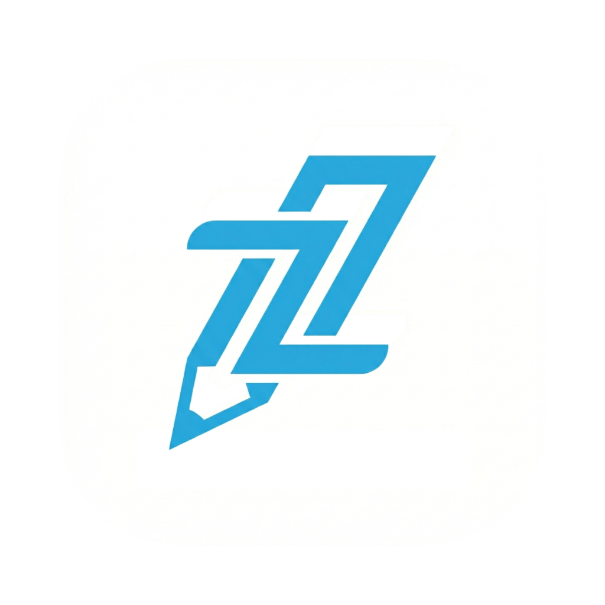
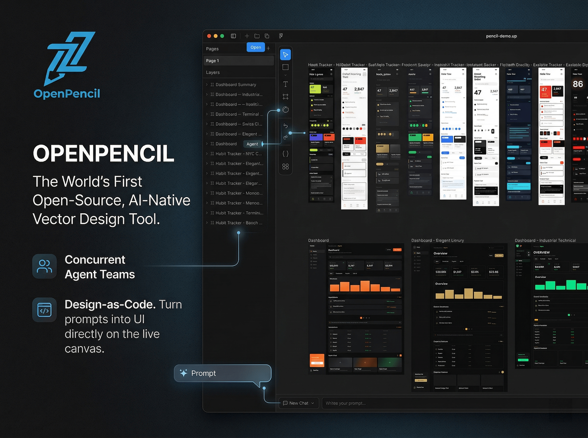
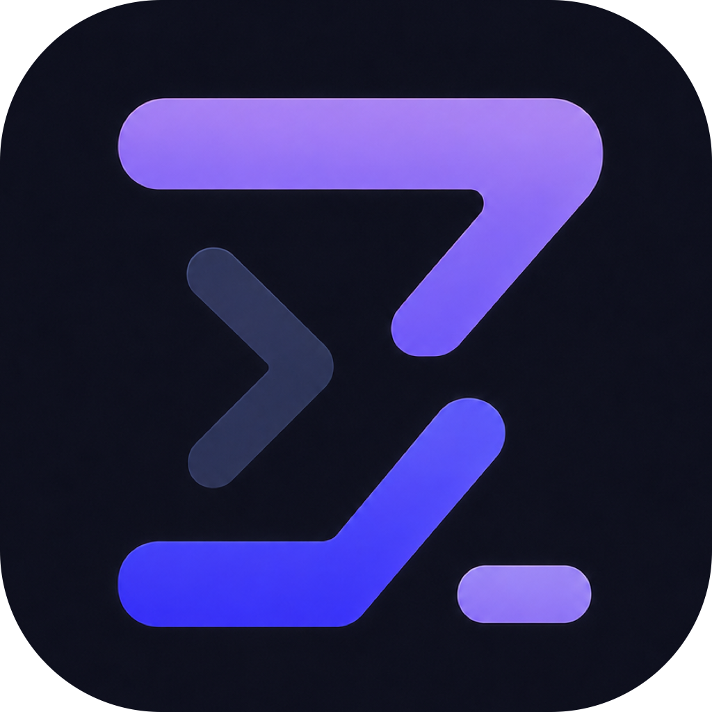
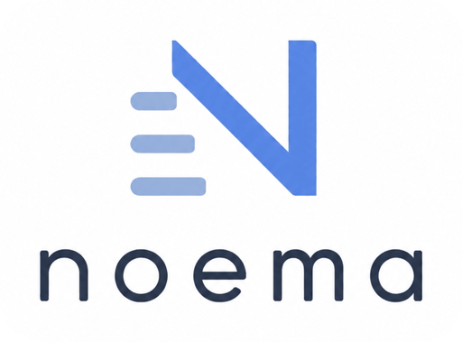

<p align="center">
  
</p>

<h1 align="center">OpenPencil</h1>

<p align="center">
  <strong>Le premier outil de design vectoriel open-source natif IA au monde.</strong><br />
  <sub>Equipes d'agents concurrents &bull; Design-as-Code &bull; Serveur MCP intégré &bull; Intelligence multi-modèles</sub>
</p>

<p align="center">
  <a href="./README.md"><b>English</b></a> · <a href="./README.zh.md">简体中文</a> · <a href="./README.zh-TW.md">繁體中文</a> · <a href="./README.ja.md">日本語</a> · <a href="./README.ko.md">한국어</a> · <a href="./README.fr.md">Français</a> · <a href="./README.es.md">Español</a> · <a href="./README.de.md">Deutsch</a> · <a href="./README.pt.md">Português</a> · <a href="./README.ru.md">Русский</a> · <a href="./README.hi.md">हिन्दी</a> · <a href="./README.tr.md">Türkçe</a> · <a href="./README.th.md">ไทย</a> · <a href="./README.vi.md">Tiếng Việt</a> · <a href="./README.id.md">Bahasa Indonesia</a>
</p>

<p align="center">
  <a href="https://github.com/ZSeven-W/openpencil/stargazers"></a>
  <a href="https://github.com/ZSeven-W/openpencil/blob/main/LICENSE"></a>
  <a href="https://github.com/ZSeven-W/openpencil/actions/workflows/rust-check.yml"></a>
  <a href="https://discord.gg/h9Fmyy6pVh"></a>
</p>

<p align="center">
  <a href="https://trendshift.io/repositories/24088?utm_source=repository-badge&amp;utm_medium=badge&amp;utm_campaign=badge-repository-24088" target="_blank" rel="noopener noreferrer"></a>
</p>

<br />

<p align="center">
  <a href="https://oss.ioa.tech/zseven/openpencil/a46e24733239ce24de36702342201033.mp4">
    
  </a>
</p>
<p align="center"><sub>Cliquez sur l'image pour regarder la vidéo de démonstration</sub></p>

## Pourquoi OpenPencil

<table>
<tr>
<td width="50%">

### 🎨 Prompt → Canevas

Décrivez n'importe quelle interface en langage naturel. Regardez-la apparaître sur le canevas infini en temps réel avec une animation en streaming. Modifiez des designs existants en sélectionnant des éléments et en conversant.

</td>
<td width="50%">

### 🤖 Équipes d'agents concurrents

L'orchestrateur décompose les pages complexes en sous-tâches spatiales. Plusieurs agents IA travaillent simultanément sur différentes sections — hero, fonctionnalités, pied de page — le tout en streaming parallèle.

</td>
</tr>
<tr>
<td width="50%">

### 🧠 Intelligence multi-modèles

S'adapte automatiquement aux capacités de chaque modèle. Claude obtient des prompts complets avec réflexion ; GPT-4o/Gemini désactivent la réflexion ; les modèles plus petits (MiniMax, Qwen, Llama) reçoivent des prompts simplifiés pour une sortie fiable.

</td>
<td width="50%">

### 🔌 Serveur MCP

Installation en un clic dans les CLI Claude Code, Codex, OpenCode, Kiro ou Copilot. Designez depuis votre terminal — lisez, créez et modifiez des fichiers `.op` via tout agent compatible MCP.

</td>
</tr>
<tr>
<td width="50%">

### 🎨 Guides de style

Bibliothèque de guides de style intégrée avec correspondance floue par tags. Appliquez des styles visuels (glassmorphism, brutalist, retro, etc.) aux designs générés par l'IA. Outils MCP pour l'accès des agents externes.

</td>
<td width="50%">

### 📦 Design-as-Code

Les fichiers `.op` sont du JSON — lisibles par l'humain, compatibles Git, comparables. Les variables de design génèrent des propriétés personnalisées CSS. Export de code vers React + Tailwind ou HTML + CSS.

</td>
</tr>
<tr>
<td width="50%">

### 🖥️ Fonctionne partout

Application web + bureau natif sur macOS, Windows et Linux — un seul cœur Rust, un binaire unique autonome, sans moteur de navigateur. Association de fichiers `.op` — double-cliquez pour ouvrir.

</td>
<td width="50%">

### ⌨️ CLI — `op`

Contrôlez l'outil de design depuis le terminal. `op design`, `op insert` — DSL de design par lots, manipulation de nœuds. Entrée par pipe depuis des fichiers ou stdin. Fonctionne avec l'app de bureau ou le serveur web.

</td>
</tr>
<tr>
<td width="50%">

### 🎯 Export de Code Multi-Plateforme

Exportez depuis un seul fichier `.op` vers React + Tailwind, HTML + CSS, Vue, Svelte, Flutter, SwiftUI, Jetpack Compose, React Native. Les variables de design deviennent des propriétés CSS personnalisées.

</td>
<td width="50%">

### 🧩 SDK intégrable

`op-web-sdk` (vanilla) + adaptateurs `op-web-sdk-react` / `op-web-sdk-vue` — intégrez une visionneuse `.op` en lecture seule dans votre propre application, propulsée par le même moteur de rendu wasm que l'éditeur.

</td>
</tr>
<tr>
<td width="50%">

### 🛡️ Kit de design system

Gérez des UIKits réutilisables avec changement de style et composition de composants. Importez/exportez des kits depuis des fichiers `.pen`. Registre intégré avec outils MCP pour l'accès externe.

</td>
<td width="50%">

### 👥 Collaboration en temps réel

Concevez ensemble via des sessions pair-à-pair authentifiées, avec un relais public et des hubs régionaux intégrés. Rejoignez avec un court code d'appairage, voyez les curseurs distants en direct et résolvez les conflits avec le détail et la relecture de chaque modification.

</td>
</tr>
</table>

## Installation

**Compiler sur Windows :** [BUILD_WINDOWS.fr.md](./docs/build_windows/BUILD_WINDOWS.fr.md)

**macOS (Homebrew) :**

```bash
brew tap zseven-w/openpencil
brew trust --tap zseven-w/openpencil
brew install --cask openpencil
```

**Windows (Scoop) :**

```powershell
scoop bucket add openpencil https://github.com/zseven-w/scoop-openpencil
scoop install openpencil
```

**Téléchargement direct Linux / Windows :** [GitHub Releases](https://github.com/ZSeven-W/openpencil/releases) — `.exe` (Windows), `.AppImage` / `.deb` (Linux)

L'installateur Windows `.exe`, les deux paquets Scoop et l'installateur CLI `install-op.ps1` vérifient et, si nécessaire, réparent le runtime Visual C++ v14 épinglé et signé par Microsoft à chaque installation ou mise à jour. Les archives Windows portables `.zip` et les paquets Windows VSIX n'exécutent pas d'installateur système avec élévation ; installez le [dernier Visual C++ Redistributable pris en charge](https://learn.microsoft.com/en-us/cpp/windows/latest-supported-vc-redist?view=msvc-170) de Microsoft avant d'utiliser directement ces artefacts.

> Votre antivirus signale l'installateur Windows ? C'est un faux positif heuristique connu pour les nouvelles versions peu répandues — voir [comment vérifier votre téléchargement](docs/security/antivirus-false-positives.md).

**Nix (Linux x86_64) :**

```bash
nix develop
nix run .                         # lancer l'application de bureau
nix build .#openpencil            # hôte web natif + bundle web CanvasKit
nix build .#op-cli                # la CLI `op`
nix build .#prebuilt              # utiliser l'archive de bureau upstream correspondante
nix build .#prebuilt-cli          # utiliser l'archive CLI upstream correspondante
nix build .#web-server            # serveur web natif sans GL + bundle web
nix build .#runtime-prebuilt      # runtime précompilé bureau + CLI `op`
nix build .#web-sdk-packages      # archives npm des SDK web
nix build .#appimage              # AppImage de bureau portable
```

Le flake utilise la toolchain Rust épinglée dans `rust-toolchain.toml` et est
actuellement publié pour `x86_64-linux`. Le flake ne produit pas encore de
paquet Debian ; utilisez les artefacts de la release upstream lorsqu'un `.deb`
est nécessaire. Les sorties `prebuilt` utilisent la version de release et les
hashes épinglés dans `nix/release-manifest.json`, indépendamment de la version
source du workspace. Après la publication d'une release, le workflow de release
ouvre une PR pour actualiser ce manifeste. Jusqu'à sa fusion, les sorties
précompilées continuent d'utiliser la release publiée précédente ; les sorties
compilées depuis les sources utilisent toujours le code extrait.

**CLI (`op`) :**

```bash
brew tap zseven-w/openpencil
brew trust --tap zseven-w/openpencil
brew install zseven-w/openpencil/op
```

Ou utilisez le script d'installation (macOS / Linux) :

```bash
curl -fsSL https://raw.githubusercontent.com/ZSeven-W/openpencil/main/scripts/install-op.sh | bash
```

Pour autoriser la préversion la plus récente :

```bash
curl -fsSL https://raw.githubusercontent.com/ZSeven-W/openpencil/main/scripts/install-op.sh | OP_PRERELEASE=1 bash
```

Windows PowerShell :

```powershell
irm https://raw.githubusercontent.com/ZSeven-W/openpencil/main/scripts/install-op.ps1 | iex
```

Pour autoriser la préversion la plus récente :

```powershell
$env:OP_PRERELEASE = "1"; irm https://raw.githubusercontent.com/ZSeven-W/openpencil/main/scripts/install-op.ps1 | iex
```

## Clonage (avec les sous-modules)

```bash
git clone --recurse-submodules https://github.com/ZSeven-W/openpencil.git
# Déjà cloné ? Synchronisez d'abord pour que les anciennes URL prennent en compte les modifications de .gitmodules :
git submodule sync --recursive && git submodule update --init --recursive
```

Trois sous-modules se trouvent sous `vendor/`. Ils sont tous publics et récupérés via HTTPS (aucune clé SSH nécessaire) : `jian` (framework UI GPU-Skia — widgets/rendu/événements), `casement` (fork de winit) et `agent` (`agent-rs` — runtime d'agents Rust partagé entre produits, utilisé par OP et Zode). `vendor/anthropic-agent-sdk` est suivi directement dans le dépôt et n'est pas un sous-module.

## Démarrage rapide

```bash
# Web dev server (builds the CanvasKit wasm bundle, then runs the headless web host)
bash scripts/start-web-rust.sh
```

Les identifiants des fournisseurs intégrés, de génération d'images et d'Openverse saisis dans le navigateur sont conservés par défaut dans le `localStorage` de même origine (`openpencil-rust-web-credentials`), séparément des préférences web ordinaires. Un identifiant nécessaire à une requête IA est envoyé avec cette requête, mais le démon n'écrit pas l'instantané du navigateur dans `settings.json`.

Les déploiements privés peuvent activer la persistance côté serveur avec `OPENPENCIL_PERSIST_WEB_CREDENTIALS_SERVER=true`. Ce paramètre s'applique à tout le déploiement ; chaque instantané de navigateur accepté remplace la copie partagée appartenant au navigateur. Ne l'activez que pour un déploiement de confiance, à accès contrôlé, avec un seul profil administrateur actif, derrière HTTPS. Désactiver le paramètre supprime au démarrage suivant les identifiants appartenant au navigateur déjà persistés, tout en conservant la configuration de l'opérateur. Comme pour tout `localStorage`, les scripts de même origine peuvent lire ces valeurs : l'origine web doit donc être protégée contre les scripts non fiables et le XSS. Avant de revenir à une version antérieure à ce paramètre, désactivez-le et lancez une fois la version actuelle pour effacer la copie appartenant au navigateur.

L'hôte web ne prend en charge que les agents intégrés à clé API. Les agents CLI et ACP restent réservés au natif : ils ne sont ni affichés dans le sélecteur de modèle web, ni stockés dans les instantanés d'identifiants du navigateur, ni synchronisés avec le serveur, ni exposés via les routes de connexion web. Les requêtes du navigateur vers les points de terminaison d'identifiants et d'IA autorisent par défaut les origines loopback/localhost. Un reverse proxy public doit définir séparément `OPENPENCIL_WEB_ALLOWED_ORIGINS` sur une liste d'origines exactes séparées par des virgules, par exemple `https://demo.openpencil.dev`.

La persistance côté serveur n'autorise pas les requêtes contrôlées par le navigateur vers des points de terminaison de fournisseur loopback, privés, link-local, de métadonnées ou réservés. Un déploiement privé de confiance qui utilise volontairement un fournisseur interne doit définir séparément `OPENPENCIL_WEB_AI_ENDPOINT_ALLOWLIST` sur une liste d'origines d'URL exactes séparées par des virgules, par exemple `http://127.0.0.1:11434,https://llm.internal.example`.

Ou lancer en tant qu'application de bureau :

```bash
cargo run -p op-host-desktop
```

> **Prérequis :** [Rust](https://www.rust-lang.org/) (stable) pour compiler le produit. [Bun](https://bun.sh/) >= 1.0 et [Node.js](https://nodejs.org/) >= 18 ne sont nécessaires que pour le SDK web dans `packages/`.

### Docker

Les releases Rust taguées publient une seule image web host. Les anciennes images TypeScript avec des CLI IA intégrés ne sont plus publiées.

| Image | Contenu |
| --- | --- |
| `ghcr.io/zseven-w/openpencil-web:vX.Y.Z` | Rust web host, wasm bundle et ressources CanvasKit |

L'interface web expose uniquement les profils d'agents intégrés ; les outils Claude/Codex/OpenCode/Copilot CLI ne sont pas inclus dans les images Docker.

**Exécuter :**

```bash
VERSION="$(scripts/workspace-version.sh)"
docker run -d -p 3100:3100 "ghcr.io/zseven-w/openpencil-web:v${VERSION}"
```

Ouvrez ensuite `http://localhost:3100/`.

**Compiler localement :**

```bash
docker build -f Dockerfile.web-rust -t openpencil-web-rust .
docker run -p 3100:3100 openpencil-web-rust
```

## Design natif IA

**Du prompt à l'interface**

- **Texte vers design** — décrivez une page, elle est générée en temps réel sur le canevas avec une animation en streaming
- **Orchestrateur** — décompose les pages complexes en sous-tâches spatiales pour une génération parallèle
- **Équipes d'agents** — membres d'équipe concurrents avec outil de délégation, indicateurs de canevas par membre et stratégies de repli
- **Modification de design** — sélectionnez des éléments, puis décrivez les modifications en langage naturel
- **Entrée vision** — joignez des captures d'écran ou des maquettes pour un design basé sur des références
- **Guides de style** — appliquez des styles visuels (glassmorphism, brutalist, retro, etc.) par correspondance floue de tags
- **Anti-répétition** — suivi de la diversité entre générations pour éviter les sorties IA répétitives

**Support multi-agents**

| Agent                         | Configuration                                                                                                           |
| ----------------------------- | ----------------------------------------------------------------------------------------------------------------------- |
| **Intégré (9+ fournisseurs)** | Choisissez parmi les préréglages de fournisseurs avec sélecteur de région — Anthropic, OpenAI, Google, DeepSeek et plus |
| **Claude Code**               | Aucune configuration — utilise le Claude Agent SDK avec OAuth local                                                     |
| **Codex CLI**                 | Connecter dans les Paramètres de l'agent (`Cmd+,`)                                                                      |
| **OpenCode**                  | Connecter dans les Paramètres de l'agent (`Cmd+,`)                                                                      |
| **GitHub Copilot**            | `copilot login` puis connecter dans les Paramètres de l'agent (`Cmd+,`)                                                 |

**Profils de capacités des modèles** — adapte automatiquement les prompts, le mode de réflexion et les délais d'attente par niveau de modèle. Les modèles de niveau complet (Claude) reçoivent des prompts complets ; le niveau standard (GPT-4o, Gemini, DeepSeek) désactive la réflexion ; le niveau basique (MiniMax, Qwen, Llama, Mistral) reçoit des prompts JSON imbriqués simplifiés pour une fiabilité maximale.

**i18n** — Localisation complète de l'interface en 15 langues : English, 简体中文, 繁體中文, 日本語, 한국어, Français, Español, Deutsch, Português, Русский, हिन्दी, Türkçe, ไทย, Tiếng Việt, Bahasa Indonesia.

**Serveur MCP**

- Serveur MCP intégré (crate `op-mcp`) — installation en un clic dans les CLI Claude Code / Codex / OpenCode / Kiro / Copilot
- Aucun besoin de Node.js — transport stdio via le binaire de bureau (`--mcp <path>`), plus un point de terminaison HTTP en direct (`127.0.0.1:<port>/mcp`) depuis l'application en cours d'exécution
- Automatisation du design depuis le terminal : lire, créer et modifier des fichiers `.op` via tout agent compatible MCP
- **Workflow de design en couches** — `design_skeleton` → `design_content` → `design_refine` pour des designs multi-sections de plus haute fidélité
- **Récupération segmentée des prompts** — chargez uniquement les connaissances de design nécessaires (schéma, layout, rôles, icônes, planification, etc.)
- **Outils de guide de style** — `get_style_guide_tags` et `get_style_guide` pour appliquer des styles visuels via MCP
- Support multi-pages — créer, renommer, réordonner et dupliquer des pages via les outils MCP

**Génération de code**

- React + Tailwind CSS, HTML + CSS, CSS Variables
- Vue, Svelte, Flutter, SwiftUI, Jetpack Compose, React Native

## CLI — `op`

Installez via Homebrew ou le script d'installation, puis contrôlez l'outil de design depuis votre terminal :

```bash
brew tap zseven-w/openpencil
brew trust --tap zseven-w/openpencil
brew install zseven-w/openpencil/op
```

```bash
curl -fsSL https://raw.githubusercontent.com/ZSeven-W/openpencil/main/scripts/install-op.sh | bash
```

```bash
curl -fsSL https://raw.githubusercontent.com/ZSeven-W/openpencil/main/scripts/install-op.sh | OP_PRERELEASE=1 bash
```

```powershell
irm https://raw.githubusercontent.com/ZSeven-W/openpencil/main/scripts/install-op.ps1 | iex
```

```powershell
$env:OP_PRERELEASE = "1"; irm https://raw.githubusercontent.com/ZSeven-W/openpencil/main/scripts/install-op.ps1 | iex
```

```bash
op start                     # Lancer l'app de bureau
op start --headless --file design.op # Lancer le serveur headless
op design @landing.txt       # Design par lots depuis un fichier
op design @ui.js             # JavaScript isolé avec boucles
op insert '{"type":"rectangle"}' # Insérer un nœud
op import:figma design.fig   # Importer un fichier Figma
cat design.dsl | op design - # Pipe depuis stdin
```

Prend en charge les chaînes en ligne, `@filepath` et stdin (`-`). Fonctionne avec l'app de bureau, le serveur web ou le serveur headless adossé à un fichier. Consultez la [référence des commandes CLI](./crates/op-cli/src/usage.txt).

**Compétence LLM** — installez le plugin [OpenPencil Skill](https://github.com/ZSeven-W/openpencil-skill) pour apprendre aux agents IA à concevoir avec `op`. Utilisez `op install` pour les agents détectés ou `op install --target codex` pour une cible précise.

## Fonctionnalités

**Canevas et dessin**

- Canevas infini avec panoramique, zoom, guides d'alignement intelligents et magnétisme
- Rectangle, Ellipse, Ligne, Polygone, Plume (Bézier), Frame, Texte
- Opérations booléennes — union, soustraction, intersection avec barre d'outils contextuelle
- Sélecteur d'icônes (Iconify) et import d'images (PNG/JPEG/SVG/WebP/GIF)
- Auto-layout — vertical/horizontal avec gap, padding, justify, align
- Documents multi-pages avec navigation par onglets

**Système de design**

- Variables de design — tokens de couleur, nombre et chaîne avec références `$variable`
- Support multi-thèmes — plusieurs axes, chacun avec des variantes (Clair/Sombre, Compact/Confortable)
- Système de composants — composants réutilisables avec instances et substitutions
- Synchronisation CSS — propriétés personnalisées auto-générées, `var(--name)` dans la sortie de code
- UIKits réutilisables — import/export de kits de composants depuis des fichiers `.pen`

**IA et agents**

- Prompt-vers-canevas avec génération en streaming et décomposition spatiale pilotée par l'orchestrateur
- Équipes d'agents concurrentes — plusieurs designers travaillent sur différentes sections en parallèle, avec des indicateurs sur le canevas par membre
- Workflow en couches — `design_skeleton` → `design_content` → `design_refine` avec des prompts ciblés par phase
- Guides de style — plus de 50 styles intégrés (glassmorphism, brutalist, retro, etc.) avec appariement flou basé sur les tags, intégrés dans la planification et la génération
- Profils de capacités multi-modèles — adapte automatiquement le mode de réflexion, l'effort et la forme du prompt selon le niveau du modèle
- Runtime d'agent intégré (Rust) + fournisseurs Anthropic, Claude Agent SDK, OpenCode, Codex, Copilot et Google Gemini API
- Passthrough au format Anthropic pour les fournisseurs LLM chinois — Kimi, Zhipu, GLM, DouBao, Ark, Bailian/DashScope, ModelScope, Coding Plans

**Collaboration**

- Sessions pair-à-pair authentifiées avec repli sur un relais public et hubs de collaboration régionaux intégrés
- Rejoignez avec un code d'appariement de 10 caractères marqué par région — aucun compte requis pour les sessions LAN
- Curseurs distants en direct, collaboration inter-comptes et un panneau de conflits avec détail par édition et rejeu des éditions écartées
- Mode multi-locataire en ligne pour le daemon `--serve-web`, authentifié auprès de l'op-hub avec partage de locataire inter-comptes
- Connexion par appareil — connectez-vous depuis le navigateur via le daemon serve-web, avec avatars de profil et noms d'utilisateur dans l'éditeur

**Présentations (Decks)**

- Six modèles de deck 16:9 avec un sélecteur de modèles, plus la planification IA de deck à la taille projecteur — une diapositive par écran
- Présentez un deck sous forme de diaporama avec des contrôles de présentateur
- Exportez un deck en PDF (une page par diapositive), un fichier HTML de diaporama autonome, un PowerPoint éditable (`.pptx`) ou une composition vidéo hyperframes
- Navigateur de diapositives en rail ; l'agent valide la géométrie des tableaux du deck (ratio, débordement, centrage) ainsi que le prompt

**Modèles et capture web**

- Centre de modèles de scène — un catalogue parcourable de 58 modèles répartis sur six scènes, ouvert depuis Fichier ▸ Nouveau depuis un modèle
- Centre de prompts avec des entrées web, dashboard, composant et modification, et des aperçus visuels de prompts
- Centre d'assets — une galerie responsive plein écran avec des modèles à double action et l'import de style DESIGN.md
- [Extension Chrome de capture web](https://chromewebstore.google.com/detail/openpencil/ahfofgelkdaobcmglejmjbpnajhpgcij) — capturez n'importe quelle page web dans OpenPencil avec une capture fidèle du HTML / de la mise en page ; les instantanés sont livrés dans la boîte de réception de votre compte sur le hub, ou téléchargés hors ligne sous forme de fichier `.op` prêt à ouvrir

**Intégration Git**

- Assistant de clonage avec authentification SSH / HTTPS et gestion des clés SSH
- Sélecteur de branches — créer, changer, supprimer, fusionner, tout depuis le panneau Git
- Cascades pull / push avec réessai d'authentification et gestion non-fast-forward
- Fusion à trois voies en mode dossier avec suivi d'état `MERGE_HEAD` sur disque
- Panneau de conflits avec cartes à trois voies par nœud / champ, éditeur JSON inline, actions groupées et bloc diff inline
- UI de paramètres distants et de clés SSH ; i18n en 15 langues sur toute la surface Git

**Export**

- Export du canevas — PNG, JPEG, WEBP, PDF (`Cmd+Shift+P`)
- Export de code — React + Tailwind, HTML + CSS, Vue, Svelte, Flutter, SwiftUI, Jetpack Compose, React Native
- Pipeline de codegen MCP incrémental — `codegen_plan`, `codegen_submit_chunk`, `codegen_assemble`, `codegen_clean`

**Import Figma**

- Importer des fichiers `.fig` en préservant la mise en page, les remplissages, les contours, les effets, le texte, les images et les vecteurs

**Application de bureau**

- macOS, Windows et Linux natifs — un binaire unique autonome (winit + GPU Skia, sans Electron)
- Association de fichiers `.op` — double-cliquez pour ouvrir, verrouillage d'instance unique
- Vérification des mises à jour en arrière-plan auprès de GitHub Releases
- Menu d'application natif avec Enregistrer sous, Ouvrir les récents et une boîte de dialogue de modifications non enregistrées à la fermeture
- Persistance des fichiers récents

## Stack technique

|                       |                                                                                             |
| --------------------- | ------------------------------------------------------------------------------------------- |
| **Cœur**              | Workspace Rust (`crates/`) — état de l'éditeur, widgets, hôtes, MCP, IA, codegen             |
| **Rendu**             | GPU Skia partout — `skia-safe` (GL) en natif, CanvasKit (WASM/WebGL2) dans le navigateur     |
| **Framework UI** | jian — framework UI GPU-Skia en Rust pur vendored : widgets, layout, événements, rechargement à chaud (`vendor/jian`) |
| **Fenêtrage**         | winit (fork vendored `casement`)                                                             |
| **Bureau**            | Binaire natif `openpencil-desktop` — sans moteur de navigateur                               |
| **SDK web**           | `op-web-sdk` + adaptateurs React 19 / Vue 3 — visualiseur `.op` en lecture seule (TypeScript) |
| **CLI**               | `op` — contrôle depuis le terminal, DSL de design par lots                                   |
| **IA**                | Runtime d'agent Rust intégré · Anthropic SDK · Claude Agent SDK · OpenCode SDK · Copilot SDK |
| **Lint**              | clippy · rustfmt (Rust) · oxlint · oxfmt (SDK web)                                           |
| **Format de fichier** | `.op` — basé sur JSON, lisible par l'humain, compatible Git                                 |

## Écosystème

OpenPencil fait partie d'une famille d'outils en Rust pur, natifs IA, développés par **[ZSeven-W](https://github.com/ZSeven-W)**. Ils se composent : `jian` effectue le rendu d'OpenPencil, `agent-rs` exécute ses agents, `noema` mémorise, et `zode` conçoit depuis le terminal.

| Projet | De quoi il s'agit |
| ------ | ----------------- |
|  **[DSH OpenPencil](./packages/op-dsh)** | Plugin DeepSeek Harness pour OpenPencil — aperçus `.op` multi-cadres exacts, un canevas interactif et un éditeur géré avec des outils de conception natifs pour agents, directement dans une conversation. |
| **[Codex OpenPencil](./packages/op-codex)** | Plugin Codex pour OpenPencil — un canevas interactif Rust/WASM pour la conception d’UI assistée par IA avec installation en un prompt, affinage par sélection et sauvegarde `.op`. |
|  **[Zode](https://github.com/ZSeven-W/zode)** | Assistant de code open-source natif IA pour votre terminal — une TUI Rust rapide (`ratatui`) qui lit votre code, exécute des commandes, recherche des fichiers et gère git. Pilote OpenPencil via MCP. |
| **[agent-rs](https://github.com/ZSeven-W/agent-rs)** | Un runtime asynchrone en Rust pur pour déployer des agents LLM — multi-fournisseurs, capable d'utiliser des outils de bout en bout, permissions structurées, vrai MCP, zéro `unsafe`. Alimente le runtime d'agent intégré d'OpenPencil (`vendor/agent`) et Zode. |
|  **[jian](https://github.com/ZSeven-W/jian)** | Framework UI GPU-Skia en Rust pur — widgets, layout, événements et rechargement à chaud dans une seule stack. Transforme un document déclaratif `.op` en une app native, contrôlable par IA, sans runtime JS, sans DOM, sans Electron. Le framework UI d'OpenPencil (`vendor/jian`). |
|  **[noema](https://github.com/ZSeven-W/noema)** | Système de mémoire local-first et non vectoriel pour les agents de code. Mémoire durable sous forme de fichiers inspectables, une file de revue pour les nouvelles entrées, et un rappel lexical (sans embedding) — fonctionne avec Zode, Codex, Claude Code et les runtimes MCP. |

## Pourquoi Rust

OpenPencil a été réécrit intégralement en **Rust** ([#129](https://github.com/ZSeven-W/openpencil/issues/129)). La réécriture est terminée — l'éditeur TypeScript + Electron a été retiré en `v0.7.5`, et le workspace Rust de ce dépôt est le produit : un cœur natif unique, nettement plus léger et plus rapide, fonctionnant sur davantage de plateformes à partir d'une seule base de code.

|                            | TypeScript + Electron (retiré, `v0.7.5`)               | Rust (aujourd'hui)                                                         |
| -------------------------- | ----------------------------------------------------- | -------------------------------------------------------------------------- |
| **Exécution bureau**       | Electron — embarque Chromium + Node.js                | Fenêtre native (`winit` + GPU Skia), sans moteur de navigateur              |
| **Empreinte bureau**       | Runtime Chromium complet par installation             | Binaire unique autonome — **55.5 MB**                                      |
| **Charge web**             | Bundle JS + WASM                                      | **8.2 MB** wasm / **2.18 MB** gzip sur le réseau                           |
| **Rendu**                  | CanvasKit/Skia sur le web                             | Un seul backend Skia accéléré GPU sur **chaque** cible                     |
| **Mémoire**                | Pauses du GC JavaScript                               | Sans GC — ownership Rust, latence prévisible                               |
| **Base de code**           | Stack web + Electron                 | Un workspace Rust : éditeur · CLI · MCP · AI · codegen · Figma · Git       |
| **Cibles**                 | Web + bureau, deux stacks séparées                    | Bureau (macOS/Win/Linux) · mobile (iOS/Android) · navigateur — un seul cœur |

**Améliorations mesurées**

- **Empreinte minimale** — l'intégralité de l'application bureau tient en un seul binaire natif de **55.5 MB**, au lieu d'un moteur de navigateur embarqué et d'un runtime Node. La version web pèse **8.2 MB** brut / **2.18 MB** gzip après découpage du catalogue d'icônes (−48% sur le réseau).
- **Passage à l'échelle sur les grands documents** — un canevas en direct de **10,000 nœuds** (auto-layout imbriqué, quatre niveaux de profondeur) écrit, lit et capture l'état de mise en page **sans panique et avec ~0% de CPU en veille** ; un snapshot complet de la mise en page des 10k nœuds est retourné en **~0.68 s**.
- **Interactions fluides** — le panoramique/zoom ne re-sérialise plus le document à chaque frame (un correctif sur un point chaud critique a ramené le CPU lors du zoom molette de **~69% à ~0%**) ; les glissés appliquent les modifications de scène de façon incrémentielle, la mesure du texte est mise en cache, et les repeints sont fusionnés en un seul par frame.
- **Un cœur, chaque écran** — le même état de l'éditeur et le même backend de rendu compilent vers le bureau natif, le mobile et le navigateur via WASM — sans réimplémentations parallèles à synchroniser.
- **GPU Skia partout** — le natif effectue le rendu via `skia-safe` sur un contexte GL ; le navigateur effectue le rendu via CanvasKit sur WebGL2 — le même code de dessin, le même résultat.
- **Accessibilité native** — AccessKit sur macOS, Windows et Linux, plus un miroir DOM sur le web, plutôt que de s'appuyer sur l'arbre a11y d'un navigateur.
- **Un workspace avec vérification de types** — l'hôte MCP, le CLI, les fournisseurs AI, la génération de code, l'import Figma et l'intégration Git résident tous dans un seul workspace Rust, avec filtrage de la chaîne d'approvisionnement par `cargo-deny` en CI.

> **Statut :** l'éditeur TypeScript a été retiré en `v0.7.5` et ne subsiste que dans l'historique Git ; ce dépôt est le workspace Rust. Le produit Rust est en développement actif (voir la Feuille de route ci-dessous).

## Structure du projet

```text
openpencil/
├── crates/                   Workspace Rust — le produit
│   ├── op-editor-core/       État canonique de l'éditeur `.op` (PenDocument) + EditorCommand + variables de design
│   ├── op-editor-ui/         Widgets indépendants de la plateforme + façade RenderBackend (wasm32-clean)
│   ├── op-editor-host-core/  Machines à états d'hôte sans transport, partagées par tous les hôtes
│   ├── op-collab/            Types wire de collaboration ouverts, hachages canoniques et application exacte
│   ├── op-collab-transport/  Transport natif Noise/TCP, admission bornée et découverte LAN optionnelle
│   ├── op-collab-smoke/      Matrice de reprise de collaboration authentifiée à deux processus
│   ├── op-host-native/       Bibliothèque hôte native — winit + skia-safe GL (bureau + mobile)
│   ├── op-engine-ffi/        ABI C du lecteur — intègre le canevas dans les shells iOS / Android
│   ├── op-engine-jni/        Couche de marshalling JNI Android pour op-engine-ffi
│   ├── op-host-web/          Bundle navigateur — cdylib wasm32, rendu CanvasKit
│   ├── op-host-desktop/      Binaire de bureau `openpencil-desktop` ; aussi le daemon `--serve-web`
│   ├── op-host-services/     Bibliothèque daemon serve-web / MCP headless
│   ├── op-host-web-server/   Binaire web-server léger, sans GL
│   ├── op-cli/               Outil CLI — commande `op`
│   ├── op-mcp/               Serveur MCP — outils, design par lots, workflow en couches
│   ├── op-ai/                Fournisseurs IA, runtime de chat, streaming
│   ├── op-ai-skills/         Moteur de compétences de prompts IA (chargement piloté par phases)
│   ├── op-orchestrator/      Orchestration d'équipes d'agents concurrentes
│   ├── op-codegen/           Générateurs de code (React, HTML, Vue, Flutter, ...)
│   ├── op-figma/             Parseur et convertisseur de fichiers Figma .fig
│   ├── op-git/               Intégration Git — clone, branche, push/pull, fusion
│   └── ...                   op-opmerge / op-pen-loader / op-design-lint / op-i18n /
│                             op-config-store / op-process-io / op-acp / op-smoke / ...
├── packages/                 SDK web et intégrations éditeur/agent
│   ├── op-web-sdk/           SDK visualiseur web `.op` en lecture seule (enveloppe le bundle wasm)
│   ├── op-web-sdk-react/     Adaptateur React 19
│   ├── op-web-sdk-vue/       Adaptateur Vue 3
│   ├── op-vscode/            Extension VS Code pour éditer les `.op` et `.fig`
│   ├── op-chrome-extension/  Extension Chrome pour capturer les pages web rendues
│   ├── op-dsh/               Plugin DeepSeek Harness (`@zseven-w/dsh-openpencil`)
│   └── op-codex/             Plugin Codex (`@zseven-w/codex-openpencil`)
├── vendor/                   Sous-systèmes vendored (sous-modules git)
│   ├── jian/                 Framework UI GPU-Skia — widgets/rendu/événements
│   ├── casement/             Fork de winit
│   └── agent/                Runtime d'agent Rust transversal (agent-rs)
└── .githooks/                Vérification pre-commit des écarts de version
```

## Raccourcis clavier

| Touche      | Action                 |     | Touche        | Action                         |
| ----------- | ---------------------- | --- | ------------- | ------------------------------ |
| `V`         | Sélectionner           |     | `Cmd+S`       | Enregistrer                    |
| `R`         | Rectangle              |     | `Cmd+Z`       | Annuler                        |
| `O`         | Ellipse                |     | `Cmd+Shift+Z` | Rétablir                       |
| `L`         | Ligne                  |     | `Cmd+C/X/V/D` | Copier/Couper/Coller/Dupliquer |
| `T`         | Texte                  |     | `Cmd+G`       | Grouper                        |
| `F`         | Frame                  |     | `Cmd+Shift+G` | Dégrouper                      |
| `P`         | Outil plume            |     | `Cmd+Shift+P` | Exporter (PNG/JPG/WEBP/PDF)    |
| `H`         | Main (panoramique)     |     | `Cmd+Shift+C` | Panneau de code                |
| `Del`       | Supprimer              |     | `Cmd+Shift+V` | Panneau des variables          |
| `[ / ]`     | Réordonner             |     | `Cmd+J`       | Chat IA                        |
| Flèches     | Déplacer de 1px        |     | `Cmd+,`       | Paramètres de l'agent          |
| `Cmd+Alt+U` | Union booléenne        |     | `Cmd+Alt+S`   | Soustraction booléenne         |
| `Cmd+Alt+I` | Intersection booléenne |     | `Cmd+Shift+S` | Enregistrer sous               |

## Scripts

```bash
# Product (Rust — run from the repo root)
cargo build --workspace              # Build all crates (add --release for prod)
cargo test --workspace               # Run all tests
cargo check --workspace              # Type check
cargo clippy --workspace --all-targets -- -D warnings   # Lint
cargo fmt --all                      # Format
bash scripts/start-web-rust.sh       # Web dev server (wasm bundle + headless host)
cargo run -p op-host-desktop         # Desktop app (binary: openpencil-desktop)
cargo run -p op-cli -- <args>        # CLI (binary: op)

# Web SDK / JS tooling (run from packages/)
cd packages && bun run lint          # Lint the web SDK (oxlint); also: bun run format
cd packages && bun run generate-iconify-catalog   # Regenerate the Rust icon catalog assets

# Synchronisation des versions (à exécuter depuis la racine du dépôt)
scripts/sync-version.sh                            # Sync all managed versions from root Cargo.toml
tools/check-version-sync.sh                        # Verify all managed versions match root Cargo.toml
```

### Détails du workspace Rust

La migration vers Rust est terminée — le workspace Rust est le produit. Spécification de lancement : `openpencil-docs/superpowers/specs/2026-05-02-rust-ification-kickoff.md` (v7 FROZEN).

```bash
# Install Rust toolchain (rust-toolchain.toml auto-pins 1.94)
rustup toolchain install 1.94
rustup target add wasm32-unknown-unknown

# build / test / lint
cargo check --workspace
cargo test --workspace
cargo clippy --workspace --all-targets -- -D warnings
cargo check --target wasm32-unknown-unknown -p op-collab --no-default-features
cargo check --target wasm32-unknown-unknown -p op-host-web --no-default-features --features web  # kickoff §1.2 wasm32 invariant
cargo deny check && cargo deny --target wasm32-unknown-unknown check bans        # cargo-deny (native + wasm32 bans; CI uses cargo-deny-action@v2)
```

**Crates d'entrée (`crates/` — cibles de build) :**

| Crate | Catégorie | wasm32 |
| --- | --- | --- |
| op-host-web | Point d'entrée du bundle navigateur — cdylib wasm32, rendu via CanvasKit | ✅ |
| op-host-native | Bibliothèque d'hôte natif — WidgetHostNative + backend skia-safe GL (desktop + mobile) | ❌ (natif uniquement) |
| op-engine-ffi | ABI C du lecteur — un moteur, trois shells (iOS Metal / Android EGL / raster hôte) | ❌ (natif uniquement) |
| op-engine-jni | Couche de marshalling JNI Android pour op-engine-ffi (thread moteur, registre, callbacks) | ❌ (natif uniquement) |
| op-host-desktop | Binaire desktop `openpencil-desktop` (winit + skia-safe GL) — aussi le démon `--serve-web` qui sert le bundle web | ❌ (natif uniquement) |
| op-cli | Outil en ligne de commande `op` | ❌ (natif uniquement) |

**Crates de bibliothèque partagées :** `op-editor-core` (état `.op` canonique), `op-editor-ui` (widgets indépendants de la plateforme + `RenderBackend`), `op-editor-host-core` (machines d'état d'hôte indépendantes du transport), `op-collab` (protocole/hachage/application exacte de collaboration ouverts et indépendants du transport), `op-collab-transport` (Noise/TCP natif, admission bornée et découverte LAN optionnelle), `op-mcp`, `op-ai`, `op-ai-skills`, `op-codegen`, `op-orchestrator`, `op-figma`, `op-git`, `op-opmerge`, `op-pen-loader`, `op-design-lint`, `op-config-store`, `op-process-io`, `op-acp`, `op-i18n`, `op-rpc-transport` — plus `op-collab-smoke` (matrice authentifiée de collaboration/reprise à deux processus) et `op-smoke` (exécuteur de tests headless de tours de design). Les lecteurs mobiles se trouvent dans `packaging/` (shells `ios` + `android` au-dessus de `op-engine-ffi` / `op-engine-jni`). Le bundle navigateur effectue son rendu via le WASM skia CanvasKit officiel (chargé séparément) ; le fork wasm `skia-safe-op` et `wasm-libc-shim`, retirés, n'existent donc plus.

**Sous-module :** `vendor/agent` → `github.com/ZSeven-W/agent-rs` (runtime d'agent Rust commun aux produits).

## Contribuer

Les contributions sont les bienvenues ! Consultez [CLAUDE.md](./CLAUDE.md) pour les détails d'architecture et le style de code.

1. Forker et cloner
2. Activer la vérification des écarts de version : `git config core.hooksPath .githooks`
3. Créer une branche : `git checkout -b feat/my-feature`
4. Exécuter les vérifications : `cargo test --workspace && cargo clippy --workspace --all-targets -- -D warnings`
5. Commiter avec [Conventional Commits](https://www.conventionalcommits.org/) : `feat(canvas): add rotation snapping`
6. Ouvrir une PR contre `main`

## Feuille de route

- [x] Variables de design & tokens avec synchronisation CSS
- [x] Système de composants (instances & substitutions)
- [x] Génération de design IA avec orchestrateur
- [x] Intégration du serveur MCP avec workflow de design en couches
- [x] Support multi-pages
- [x] Import Figma `.fig`
- [x] Opérations booléennes (union, soustraction, intersection)
- [x] Profils de capacités multi-modèles
- [x] Workspace Cargo avec crates Rust et packages de SDK web réutilisables
- [x] Éditeur Rust pour bureau et web
- [x] Outil CLI (`op`) pour le contrôle depuis le terminal
- [x] Runtime d'agents Rust intégré avec support multi-fournisseurs
- [x] i18n — 15 langues
- [x] SDKs de visualisation basés sur wasm pour JavaScript, React et Vue
- [x] Style Guides avec correspondance par tags et outils MCP
- [x] Agent Teams concurrents avec délégation et indicateurs sur le canevas
- [x] Intégration Git (clone, branche, push/pull, fusion à trois voies en mode dossier)
- [x] Export du canevas (SVG / PNG / JPEG / WEBP / PDF)
- [x] Édition collaborative — P2P authentifié, relais public et hubs régionaux
- [x] Présentations (decks) — modèles, présentateur de diaporama et export PDF/HTML/PPTX/vidéo
- [x] Connexion par appareil et hébergement web multi-locataire en ligne
- [x] Extension Chrome de capture web avec import HTML / instantané de navigateur
- [ ] Système de plugins

## Contributeurs

<a href="https://github.com/ZSeven-W/openpencil/graphs/contributors">
  
</a>

## Sponsors

OpenPencil est gratuit et open source. Le développement est financé par celles et ceux qui le trouvent utile — merci de garder le canevas ouvert.

<a href="https://github.com/mrqyun" title="MrQyun">
  
</a>

Merci à **[MrQyun](https://github.com/mrqyun)** — vous voulez voir votre nom ici ? **[Devenir sponsor →](https://github.com/sponsors/ZSeven-W)**

## Communauté

<a href="https://discord.gg/h9Fmyy6pVh">
  
  <strong> Rejoindre notre Discord</strong>
</a>
— Posez des questions, partagez vos designs, suggérez des fonctionnalités.

**Communauté reconnue : [LINUX DO](https://linux.do/)**

## Bibliothèques tierces dérivées

Nous remercions les mainteneurs des projets en amont sur lesquels repose OpenPencil. Ces copies ne sont maintenues que pour répondre aux besoins d’intégration propres à OpenPencil :

- **[casement](https://github.com/ZSeven-W/casement)** — un fork de **[winit](https://github.com/rust-windowing/winit)**.
- **[anthropic-agent-sdk](./vendor/anthropic-agent-sdk)** — intégrée à partir de **[bartolli/anthropic-agent-sdk](https://github.com/bartolli/anthropic-agent-sdk)** et maintenue comme fork local.

Chaque projet reste soumis à sa licence en amont respective.

## Évaluations

[](https://mseep.ai/app/zseven-w-openpencil)

## Licence

[MIT](./LICENSE) — Copyright (c) 2026 ZSeven-W
