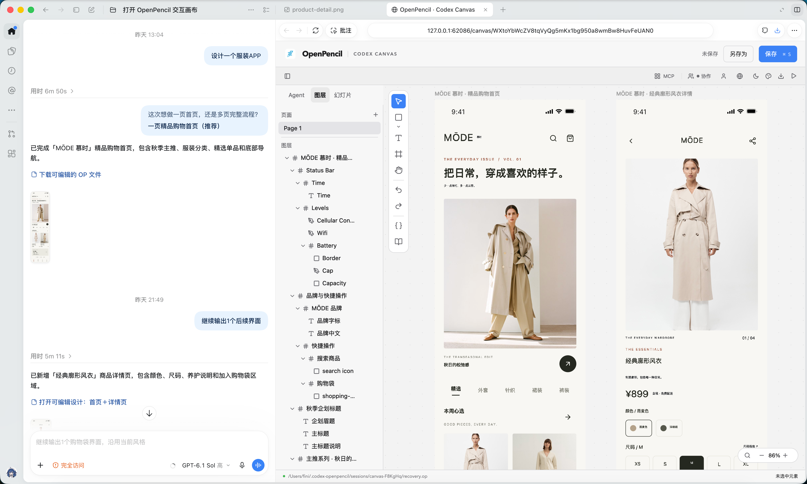
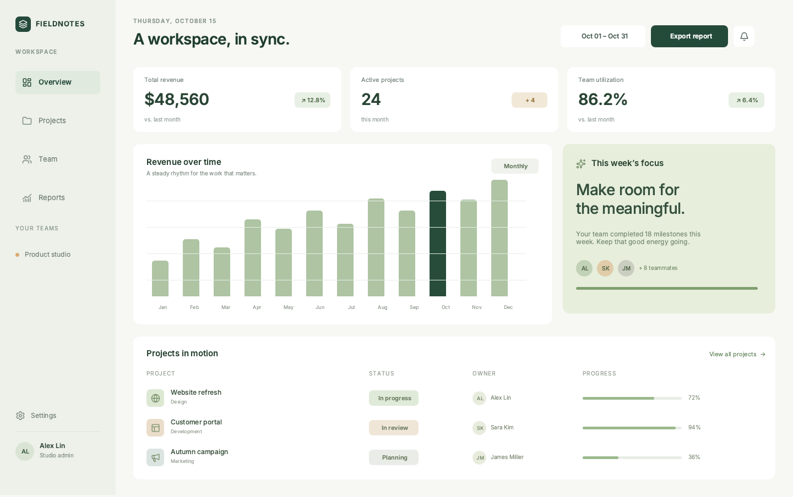
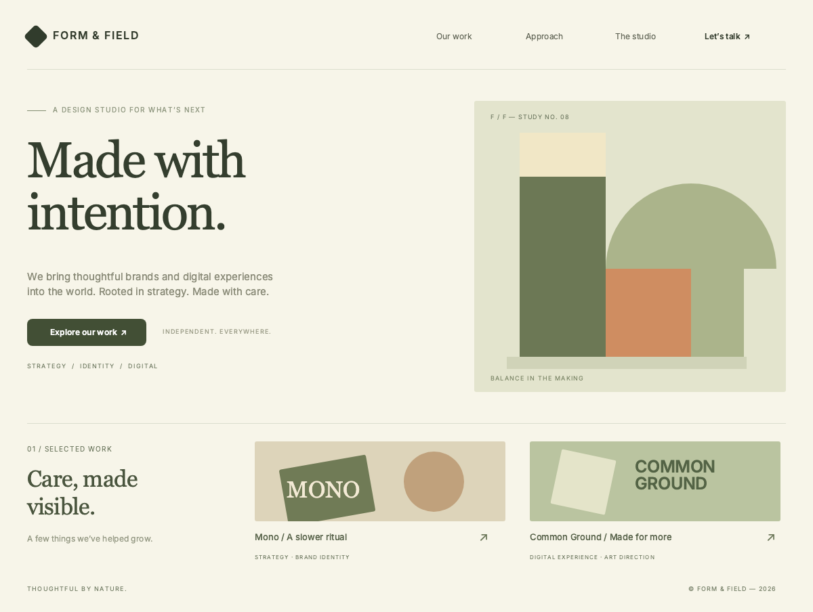
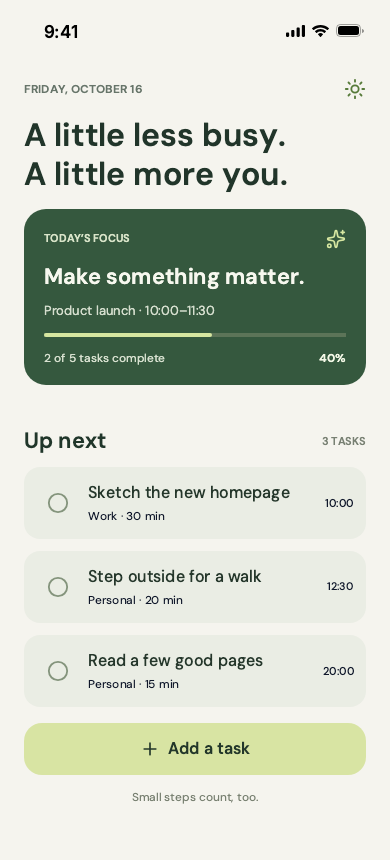

<p align="center">
  
</p>

<h1 align="center">Codex OpenPencil</h1>

<p align="center">
  <strong>The Codex plugin for OpenPencil — create, inspect, and refine editable <code>.op</code> designs from a conversation.</strong><br />
  <sub>One-Prompt Setup &bull; Interactive Canvas &bull; Selection Prompts &bull; Native Rust Engine</sub>
</p>

<p align="center">
  <a href="./README.md"><b>English</b></a> · <a href="./README.zh.md">简体中文</a>
</p>

<p align="center">
  <a href="https://github.com/ZSeven-W/openpencil/releases"></a>
  <a href="https://github.com/ZSeven-W/openpencil/actions/workflows/codex-check.yml"></a>
  <a href="./INSTALL.md"></a>
  <a href="https://github.com/ZSeven-W/openpencil/stargazers"></a>
  <a href="./LICENSE"></a>
  <a href="https://discord.gg/h9Fmyy6pVh"></a>
</p>

<p align="center">
  <a href="#one-prompt-install-and-first-design">Quick Start</a> · <a href="#why-codex-openpencil">Features</a> · <a href="#design-examples">Examples</a> · <a href="#ecosystem">Ecosystem</a> · <a href="./INSTALL.md">Install Guide</a> · <a href="./docs/validation.md">Validation</a>
</p>

<br />

<p align="center">
  
</p>
<p align="center"><sub>Design in a Codex conversation, refine on an editable OpenPencil canvas — MŌDE fashion app home and product detail screens.</sub></p>

## One-prompt install and first design

> **Image generation is enabled by default.** When a design needs new image assets, Codex uses its built-in image generation, which may consume your Codex image-generation quota. Say **“use stock images only”** to skip generation. Unavailable or failed generation falls back to stock search.

Give Codex this:

```text
Install and set up https://github.com/ZSeven-W/openpencil following packages/op-codex/INSTALL.md, open an editable canvas, and create a single-page mobile task app.
```

[INSTALL.md](./INSTALL.md) guides Codex through prerequisites, installation, runtime verification, opening the canvas, and completing the first design. Setup downloads the complete Rust editor, matching WASM, CanvasKit, fonts, and templates for your OS and CPU, then verifies a real native edit, save, and reopen before registering the plugin.

You need **Node.js 22+, Git, and a recent local Codex client with plugin support**. No GitHub account, API key, DSH, Rust compiler, separate OpenPencil desktop app, or npm dependency install is needed for this plugin's setup.

Prefer to install manually?

```sh
git clone https://github.com/ZSeven-W/openpencil.git
cd openpencil/packages/op-codex
npm run setup
```

Keep the checkout in a persistent location. Setup registers it as a local marketplace and installs `openpencil@zseven-openpencil`. A newly installed plugin may need reconnecting or a new chat to load its tools; the [terminal canvas](./INSTALL.md#instructions-for-the-installing-agent) lets Codex complete the first design in the installation chat.

Setup also verifies the tools through Codex's actual plugin loader. It records your current Node executable privately, so a desktop PATH that differs from your terminal does not prevent startup. Use `npm run host-check` to diagnose plugin loading without opening a chat or editing a design.

| Platform | Runtime builds | System requirements |
| --- | --- | --- |
| macOS | Apple Silicon, Intel | Built on macOS 15 native runners |
| Windows | ARM64, x64 | Matching Microsoft Visual C++ v14 Redistributable |
| Linux | ARM64, x64 | glibc, fontconfig, and FreeType; Ubuntu 24.04+ ARM64 / 22.04+ x64 |

See the [full compatibility table and dependency guidance](./INSTALL.md#supported-runtime-builds). Fresh installation and native edit/save/reopen checks passed on all six OS/CPU builds; [validation records](./docs/validation.md) distinguish these checks from bare-OS provisioning and embedded host UI verification.

## Why Codex OpenPencil

Codex OpenPencil connects Codex to the local Rust [OpenPencil](https://github.com/ZSeven-W/openpencil) engine. The result is a real vector document with editable layers, text, shapes, and layout.

<table>
<tr>
<td width="50%" valign="top">

### 🎨 Prompt → Canvas

Describe a dashboard, mobile screen, or landing page. Codex creates and refines native design nodes, inspects layout, and renders previews before saving the result.

</td>
<td width="50%" valign="top">

### ✏️ Interactive Editing

Select layers, pan and zoom, edit text, draw shapes, and undo changes. Mouse edits and Codex tools work on the same document in a managed Rust editor.

</td>
</tr>
<tr>
<td width="50%" valign="top">

### 🎯 Select → Refine

Select one or more elements and describe the change. Captured page and node IDs keep the request attached to those elements and their descendants, even if you select something else later.

</td>
<td width="50%" valign="top">

### 📦 Automatic Runtime Setup

The matching runtime downloads on demand for macOS, Windows, or Linux, on ARM64 or x64. Archive and payload hashes are verified before use; valid custom runtimes stay selected.

</td>
</tr>
<tr>
<td width="50%" valign="top">

### 💾 Editable Files & Recovery

Save portable `.op` files and reopen them later. Each chat owns a separate canvas and recovery draft; source conflict checks and guarded Save As protect existing files.

</td>
<td width="50%" valign="top">

### 🌗 Follows Your Workspace

The panel and editor follow the host's light/dark appearance without reloading the document. Phone designs use the Rust engine's standard status bar.

</td>
</tr>
</table>

## Design with Codex

### 1. Open a canvas

After installation and any required reconnect, ask:

> Open an interactive OpenPencil canvas for this conversation. Create a single-page dashboard for a small design studio.

You can shorten OpenPencil to **op / OP**, for example “Use OP to design a single-page mobile task manager” or “Use op to edit the selected button”. Chinese prompts such as “用op设计一个单页 APP” work too.

You can also choose **+ → OpenPencil Canvas → 在 Codex 中打开 (Open in Codex)** in the desktop app's right panel. The launcher sends an opening request to the current chat, and Codex opens the canvas in its built-in browser. It confirms the connection after the native editor is ready. If the host does not support this handoff, use **复制打开指令 (Copy opening instruction)** and send it in the current chat.

`canvas_open_browser` starts a separate managed Rust editor and returns its URL for Codex's browser panel. Codex verifies the connection and follows the bundled `openpencil-design` workflow to create, inspect, preview, and save the design. Use another chat for another document; opening an existing `.op` file copies it into the session.

The sidebar offers Layers and Slides. Slide cards show live board previews; click a card to navigate to its board. Conversation stays in Codex, so the embedded editor hides its own Agent tab.

### 2. Select elements and describe a change

Select a card or heading on the canvas, then tell Codex:

> Make the selected card dark green and enlarge its heading. Keep the other elements unchanged.

Select elements in the canvas, then describe your edit in the current Codex chat. Codex reads `canvas_selection` to resolve the active page and node IDs, and confines edits to those subtrees. No copying requests or element IDs is needed.

The canvas footer only shows the selected count and names. Selection context syncs to capable hosts without sending chat messages. Instructions, edit progress and results stay in Codex; there is no second prompt box inside the canvas. Codex verifies the current selection before editing, then inspects the preview and saved design.

### Images and generation quota

New photos, illustrations and product imagery use Codex's built-in `image_gen` by default and may consume image-generation quota. Suitable existing or user-provided images are preserved. Say **“不要生图”**, **“只搜图”** or **“use stock images only”** to use stock search throughout the task.

Before generation, Codex sends a brief chat progress update with the intended assets and possible quota use, then continues without a separate per-call permission question. The host's own required approvals still apply. Unavailable or failed generation uses the native stock-search fallback, with the outcome reported. Uncertain generation calls are not blindly retried, and missing stock results are reported honestly. No generation toggle or provider setup is added to the canvas.

Generated assets are saved in your project and imported into individual editable image nodes. `canvas_import_image` embeds local PNG/JPEG/WebP bytes, verifies the current page/document version and preserves the node's layout. The workflow then inspects the native preview and verifies the saved `.op`. The bridge does not invoke image providers or manage your quota: the design skill guides Codex, while the host owns generation access and accounting.

### 3. Preview, save, and reopen

> Check the layout, show me a preview, and save this design as an .op file in my project.

The design workflow checks native layout and the rendered PNG, then reads the saved result back. The panel's **Save** button flushes pending browser edits before writing. Changes to the source file outside the editor stop replacement; **Save As** refuses an existing destination. Recovery drafts persist in `~/.codex-openpencil/sessions/`.

## Design examples

These single-page examples were created with native OpenPencil tools and visually inspected. The dashboard and landing page come from the three-case design test; the task app comes from the v0.3.0 first-use test. All were saved and reopened; these images are native renders of editable documents.

<p align="center">
  
</p>
<p align="center"><sub>FIELDNOTES — a desktop dashboard rendered from an editable <code>.op</code> document, saved and reopened during design testing.</sub></p>

<table>
<tr>
<td width="72%" align="center" valign="top">
  
  <br /><strong>FORM &amp; FIELD</strong><br /><sub>Brand landing page · editorial typography and vector artwork</sub>
</td>
<td width="28%" align="center" valign="top">
  
  <br /><strong>A little less busy.</strong><br /><sub>Mobile task app · native status bar and editable task cards</sub>
</td>
</tr>
</table>

## Advanced setup

<details>
<summary><strong>Runtime configuration and updates</strong></summary>

First canvas use also installs a missing runtime automatically. Private settings stay in `~/.codex-openpencil/runtime.json`; downloaded binaries and machine paths are separate from the plugin package. Failed downloads never activate partial runtimes, and invalid existing configuration is reported explicitly.

To select a complete custom runtime:

```sh
npm run configure-runtime -- /absolute/path/to/runtime
```

To update, inspect the checkout for local changes, pull the published changes, and rerun `npm run setup`. Reconnect the plugin afterward; merely closing and reopening its canvas tab can retain the old running bridge. Toggle the plugin off/on in plugin management, or restart Codex if necessary. Valid custom runtimes remain selected, and an interrupted managed upgrade retains the previous configuration. See [repair and update instructions](./INSTALL.md#repair-update-and-manual-runtime).

</details>

<details>
<summary><strong>Connect an existing desktop editor</strong></summary>

Open Rust OpenPencil, enable MCP in Agent Settings, and run:

```sh
npm run doctor
# An intentional isolated endpoint:
npm run doctor -- --port 3100
```

Before a managed canvas opens, the bridge reads `~/.openpencil/.op-mcp-port` and verifies the server identity and matching instance token before forwarding to loopback `/mcp`. It rejects stale records, unrelated listeners, and legacy REST endpoints. Once managed, all native tools route to the owned daemon, including guarded `save_document`. Failed writes are never retried automatically.

Canvas controls remain discoverable with the desktop editor offline. Reconnect after starting the editor to refresh the native catalog. Explicit local ports can use `OPENPENCIL_MCP_PORT` or `--port PORT`. Existing direct MCP configuration may expose duplicate tools; setup preserves unrelated settings.

</details>

<details>
<summary><strong>Host compatibility and current limits</strong></summary>

Codex opens the editable canvas in its browser panel through `canvas_open_browser`. The MCP Apps entrypoint is in the right panel's **＋ → OpenPencil Canvas** menu. Current Codex versions reject local HTTP iframes. Where the host supports chat messages, the entrypoint asks the current Codex chat to open the same canvas in its built-in browser; it waits for an editor-ready receipt before showing a connection. Otherwise, copy the opening instruction and send it in the current chat. The plugin does not launch your system browser. Hosts that permit the declared local frame origin can embed the canvas. The URL is temporary; closing the plugin stops only its owned Rust process, while recovery drafts remain available.

MCP Apps use the initial host theme and live theme notifications. A launched browser canvas starts with that theme; panels opened without a theme use `prefers-color-scheme`. Codex's in-app browser supplies its resolved app theme.

Native resource loading, browser interaction and embedded host presentation are separate checks. Codex's current HTTP iframe restriction prevents embedded canvas presentation. All hosts use the current Codex chat for edit instructions. In the browser canvas, click Code panel Generate and say “继续转代码” in chat; automatic prompt delivery is available only in an embedded host that supports messaging. See [evidence and remaining checks](./docs/validation.md).

This plugin is distributed through the public GitHub repository and releases. It has not been submitted to OpenAI's public Plugin Directory.

</details>

## Design → Code

Select a frame, open the right **Code** panel, choose a framework and click **Generate**. The panel first shows baseline source for preview, copy and download. An embedded host with MCP Apps messaging hands the captured target to the current Codex chat for a runnable implementation and checks. In a standalone browser, say **“continue converting to code”** in Codex. Codex returns the primary source to the panel; the full project and supporting files remain in your workspace. A changed design requires a fresh request.

## Development and verification

```sh
npm run check
npm test
# Native/runtime changes also need the relevant isolated smoke checks:
npm run smoke -- --binary /path/to/openpencil-desktop
npm run canvas-smoke
npm run codegen-smoke
npm run selection-smoke -- --runtime /absolute/path/to/runtime --output /absolute/evidence-dir
npm run mobile-smoke -- --runtime /absolute/path/to/runtime --output /absolute/evidence-dir
# Keep an isolated canvas open for interactive verification:
npm run canvas-smoke -- --hold
```

The smoke runners use isolated file-backed Rust hosts and ignored `artifacts/` outputs. They terminate only their own processes. CI checks packaging and protocol behavior on Linux, macOS, and Windows with Node.js 22/24. A complete compatible runtime is required for native smoke checks.

```text
packages/op-codex/
├── .agents/plugins/          Package marketplace manifest (root .agents/plugins/ registers from repo root)
├── plugins/openpencil/      Portable Codex plugin
│   ├── plugin.json          Plugin identity, branding, and capabilities
│   ├── mcp.json             Dependency-free Node.js stdio bridge
│   ├── scripts/             Runtime installation, sessions, and canvas routing
│   ├── ui/                  MCP Apps wrapper and interactive canvas panel
│   └── skills/              Setup diagnostics and design workflow
├── scripts/                 Setup, packaging, and native smoke runners
├── tests/                   Protocol, selection, theme, and installer regressions
├── docs/                    Architecture, validation, and design previews
└── INSTALL.md               One-prompt installation guide for the agent
```

After plugin edits, reinstall with `codex plugin add openpencil@zseven-openpencil` and reconnect to refresh the cached package. Read the [architecture](./docs/architecture.md) for process ownership, persistence, and UI contracts.

## Ecosystem

Codex OpenPencil brings **[OpenPencil](https://github.com/ZSeven-W/openpencil)** into Codex. It belongs to the **[ZSeven-W](https://github.com/ZSeven-W)** ecosystem: `jian` supplies the editor UI, `agent-rs` runs OpenPencil's built-in agents, and companion tools add terminal workflows, mobile workspaces, memory, delegation and QA.

| | Project | What it does |
| :---: | --- | --- |
|  | **[OpenPencil](https://github.com/ZSeven-W/openpencil)** | The Rust vector design engine behind this plugin — editable documents, layouts, rendering, and native MCP tools. |
|  | **[DSH OpenPencil](../op-dsh)** | The sibling DeepSeek Harness integration — exact previews, an interactive canvas, and a managed editor inside DSH. |
|  | **[agent-rs](https://github.com/ZSeven-W/agent-rs)** | Rust agent runtime powering OpenPencil's built-in agents, with model providers, tools, permissions and MCP. |
|  | **[jian](https://github.com/ZSeven-W/jian)** | The GPU-Skia Rust UI framework used by OpenPencil. |
|  | **[Zode](https://github.com/ZSeven-W/zode)** | AI coding assistant for the terminal that can drive OpenPencil through MCP. |
|  | **[Rish App](https://github.com/ZSeven-W/rish-app)** | Your pocket agent — conversations, workspaces and tool execution on your phone, with model choice and operation approvals. |
|  | **[noema](https://github.com/ZSeven-W/noema)** | Local-first agent memory with inspectable files, review queues, lexical recall and MCP. |
|  | **[DSH Crew](https://github.com/ZSeven-W/dsh-crew)** | Dispatch work from Codex or Claude Code to DeepSeek Harness agents, with native progress reporting. |
|  | **[Craft Skills](https://github.com/ZSeven-W/craft-skills)** | Research- and evaluation-driven agent skills for image workflows, visual design and asset verification. |
|  | **[DSH QA](https://github.com/ZSeven-W/dsh-qa)** | Evidence-based app exploration and replayable QA scenarios across browser, desktop, iOS and Android drivers. |

For the standalone OpenPencil editor, see the **[Homebrew tap](https://github.com/ZSeven-W/homebrew-openpencil)** for macOS and **[Scoop bucket](https://github.com/ZSeven-W/scoop-openpencil)** for Windows. This Codex plugin installs its matching editor runtime through its own setup flow.

## Contributing

Contributions are welcome! Create a branch, run `npm run check` and `npm test`, use [Conventional Commits](https://www.conventionalcommits.org/), and open a PR against `main`. Runtime changes also need the relevant native smoke checks. This package owns Codex packaging, the bridge, canvas integration, and workflows inside [OpenPencil](https://github.com/ZSeven-W/openpencil).

## Community

**[Join our Discord](https://discord.gg/h9Fmyy6pVh)** — ask questions, share designs, and suggest features.

## License

[MIT](./LICENSE) — Copyright (c) 2026 ZSeven-W. Third-party attribution is in [NOTICE](./NOTICE). This is an independently maintained OpenPencil integration, not an OpenAI-authored plugin.
