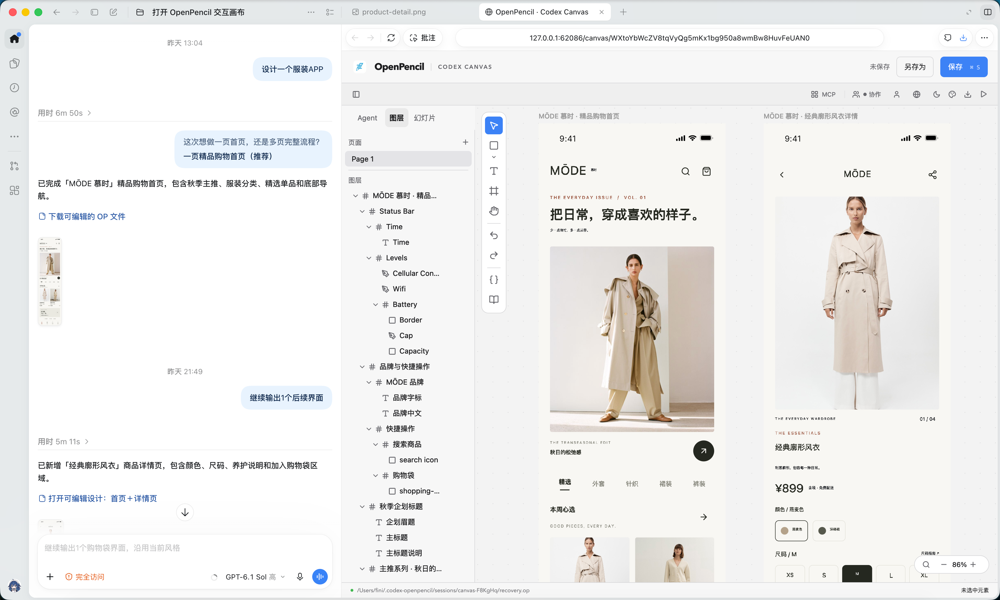
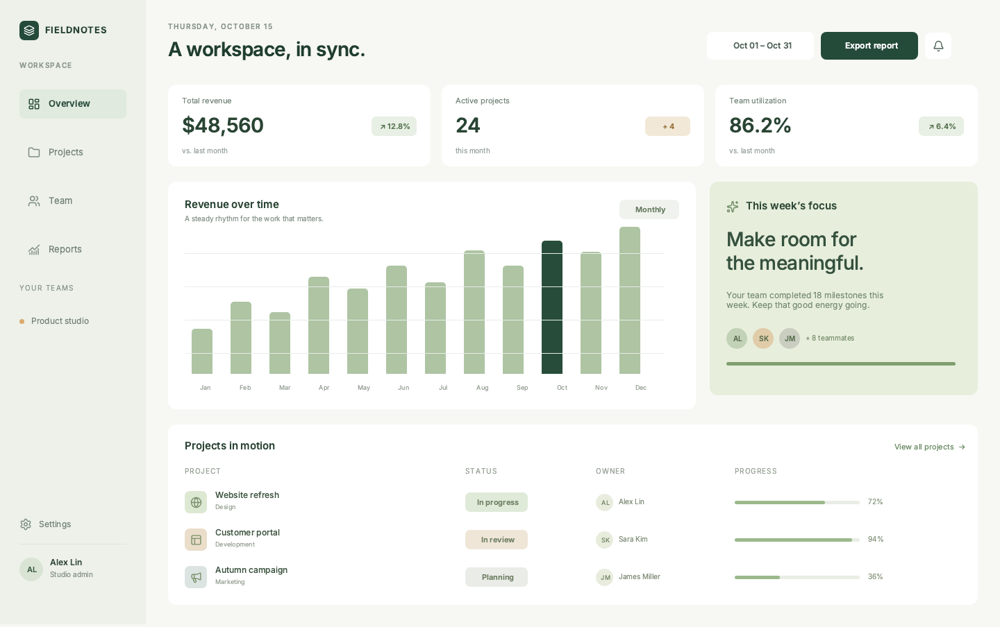
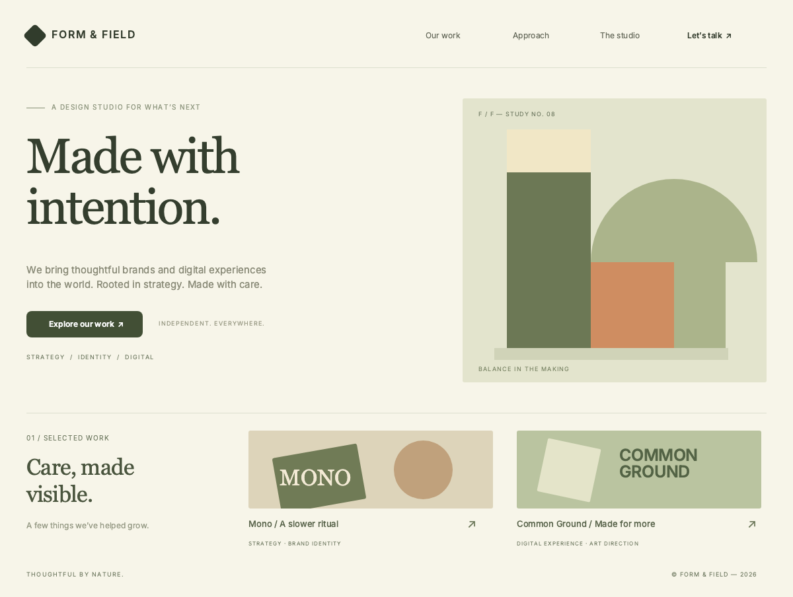
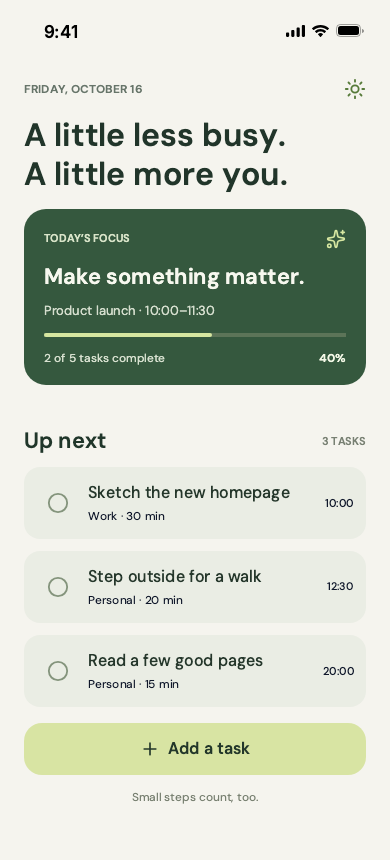

<p align="center">
  
</p>

<h1 align="center">Codex OpenPencil</h1>

<p align="center">
  <strong>OpenPencil 的 Codex 插件 —— 在对话中创建、检查并修改可编辑的 <code>.op</code> 设计。</strong><br />
  <sub>一句话安装 &bull; 交互式画布 &bull; 选区提示词修改 &bull; 原生 Rust 引擎</sub>
</p>

<p align="center">
  <a href="./README.md">English</a> · <a href="./README.zh.md"><b>简体中文</b></a>
</p>

<p align="center">
  <a href="https://www.npmjs.com/package/@zseven-w/codex-openpencil"></a>
  <a href="https://github.com/ZSeven-W/openpencil/actions/workflows/codex-check.yml"></a>
  <a href="./INSTALL.md"></a>
  <a href="https://github.com/ZSeven-W/openpencil/stargazers"></a>
  <a href="./LICENSE"></a>
  <a href="https://discord.gg/h9Fmyy6pVh"></a>
</p>

<p align="center">
  <a href="#一句话安装并开始设计">快速开始</a> · <a href="#为什么选择-codex-openpencil">功能特性</a> · <a href="#设计示例">设计示例</a> · <a href="#生态">生态项目</a> · <a href="./INSTALL.md">安装指南</a> · <a href="./docs/validation.md">验证记录</a>
</p>

<br />

<p align="center">
  
</p>
<p align="center"><sub>在 Codex 中对话设计，在 OpenPencil 画布中继续编辑 —— MŌDE 慕时服装 APP 首页与商品详情页。</sub></p>

## 一句话安装并开始设计

> **默认启用 AI 生图，可能消耗 Codex 生图额度。** 设计需要新图片时，Codex 会使用内置生图能力；说“不要生图”或“只搜图”即可改用搜图素材。生图不可用或失败时自动走搜图兜底。

把这句话发给 Codex：

```text
按照 https://github.com/ZSeven-W/openpencil/blob/main/packages/op-codex/INSTALL.md 帮我安装并配置 @zseven-w/codex-openpencil，打开可编辑画布，做一个单页手机任务管理 APP。
```

[INSTALL.md](./INSTALL.md) 会引导 Codex 检查依赖、通过 npm 安装插件、验证运行环境、打开画布，并完成第一份设计。安装 `@zseven-w/codex-openpencil` 会通过 npm `optionalDependencies` 按系统和 CPU 自动拉取匹配的单一平台运行包（`@zseven-w/codex-openpencil-<os>-<cpu>`，包含完整 Rust 编辑器、对应 WASM、CanvasKit、字体与模板），`codex-openpencil setup` 会先校验所有文件 SHA-256 并验证真实编辑、保存和重新打开，再注册插件。

需要 **Node.js 22+（含 npm）和支持插件的新版本本地 Codex**。安装本插件不需要 `git clone`、GitHub 账号、API Key、DSH、Rust 编译器或独立 OpenPencil 桌面端。

也可以手动安装：

```sh
npm install -g @zseven-w/codex-openpencil@latest
codex-openpencil setup
```

安装脚本将已安装的 npm 包注册为本地 `zseven-openpencil` 插件市场，安装 `openpencil@zseven-openpencil`。新插件可能需要重新连接或新建聊天才能加载工具；[终端画布入口](./INSTALL.md#instructions-for-the-installing-agent)（`codex-openpencil canvas`）可让 Codex 在安装时的聊天中直接完成第一份设计。

安装还会通过 Codex 的真实插件加载器检查工具，并私下记录当前 Node 可执行文件路径，解决桌面端 PATH 与终端不同导致的启动失败。可运行 `codex-openpencil host-check` 诊断加载状态；它不会新建聊天或修改设计。

| 平台 | 运行包 | 系统要求 |
| --- | --- | --- |
| macOS | Apple Silicon、Intel | 基于 macOS 15 原生 runner 构建 |
| Windows | ARM64、x64 | 对应架构的 Microsoft Visual C++ v14 运行库 |
| Linux | ARM64、x64 | glibc、fontconfig 和 FreeType；ARM64 为 Ubuntu 24.04+，x64 为 22.04+ |

完整要求见[兼容性表与依赖说明](./INSTALL.md#supported-runtime-builds)。六种系统与 CPU 组合均通过空配置安装和原生编辑、保存、重开验证；[验证记录](./docs/validation.md) 分别说明应用安装、系统依赖和宿主内嵌 UI 的验证范围。

## 为什么选择 Codex OpenPencil

Codex OpenPencil 将 Codex 连接到本地 Rust [OpenPencil](https://github.com/ZSeven-W/openpencil) 引擎，生成带有真实图层、文字、形状与布局的可编辑矢量文档。

<table>
<tr>
<td width="50%" valign="top">

### 🎨 提示词 → 画布

描述一个数据看板、手机页面或品牌落地页，Codex 通过原生设计节点创建和修改内容，检查布局、渲染预览，再保存成稿。

</td>
<td width="50%" valign="top">

### ✏️ 交互式编辑

选择图层、平移缩放、编辑文字、绘制形状与撤销操作。鼠标操作和 Codex 工具在同一个托管 Rust 编辑器中修改同一份文档。

</td>
</tr>
<tr>
<td width="50%" valign="top">

### 🎯 选中 → 修改

选中一个或多个元素，再描述修改要求。请求固定提交时的页面和节点 ID，即使后续更换选区，修改目标仍是原来的元素及其子节点。

</td>
<td width="50%" valign="top">

### 📦 按平台选择的 npm 运行包

六个原子化原生平台运行包（`@zseven-w/codex-openpencil-<os>-<cpu>`）覆盖 macOS、Windows 和 Linux 的 ARM64 / x64。npm 自动只拉取当前平台包，启动前校验全部文件 SHA-256，保留已有的有效自定义运行环境。

</td>
</tr>
<tr>
<td width="50%" valign="top">

### 💾 可编辑文件与恢复

保存为可迁移的 `.op` 文件，随时重新打开。每个聊天拥有独立画布和恢复草稿，源文件冲突检查与另存为保护已有文件。

</td>
<td width="50%" valign="top">

### 🌗 跟随工作区外观

面板和编辑器跟随宿主的深浅主题，切换时无需重新加载文档。手机设计使用 Rust 引擎提供的标准状态栏。

</td>
</tr>
</table>

## 在 Codex 中设计

### 1. 打开画布

安装并完成必要的重连后，提出：

> 打开这个聊天的 OpenPencil 交互画布，为一个小型设计工作室做单页数据看板。

也可以简称 **op / OP**，例如“用 op 设计一个单页手机任务管理 APP”或“用 OP 修改选中的按钮”。

也可以从桌面端右侧面板选择 **＋ → OpenPencil Canvas → 在 Codex 中打开**。入口会将打开请求发送到当前聊天，由 Codex 在内置浏览器中打开画布；原生编辑器就绪后，入口显示连接成功。宿主不支持自动交接时，点击**复制打开指令**，粘贴到当前聊天并发送即可。

`canvas_open_browser` 启动独立的托管 Rust 编辑器，并返回供 Codex 浏览器面板打开的地址。Codex 验证连接后，按内置 `openpencil-design` 工作流创建、检查、预览并保存设计。另一份文档使用另一个聊天；打开已有 `.op` 文件时，会先复制到当前独立会话。

侧栏提供图层和幻灯片。幻灯片卡片显示画板的实时缩略图，点击即可定位到对应画板。对话留在 Codex，嵌入编辑器隐藏自身的 Agent tab。

### 2. 选中元素，用提示词修改

在画布中选择卡片或标题，然后告诉 Codex：

> 把选中的卡片改成深绿色，标题放大，其他元素保持原样。

在画布中选中元素，然后直接在当前 Codex 聊天描述修改。Codex 通过 `canvas_selection` 读取当前页面和选中节点，将修改限定在这些子树内。无需复制请求或元素 ID。

画布底栏只显示选中数量和名称，选区上下文会静默同步给支持的宿主。要求、进度和结果都留在当前 Codex 聊天，画布内没有第二个输入框。Codex 会核对实际选区，检查修改后的预览和保存结果。

### 图片与生图额度

设计需要新的照片、插画或产品图时，默认由 Codex 调用内置 `image_gen`，可能消耗生图额度。合适的现有图片和用户提供的素材会保留。用户说“不要生图”“只搜图”后，当前任务会遵循该要求。

生图前，Codex 在聊天里简短提示用途和可能的额度消耗，随后继续执行，无需逐次确认；宿主自身要求的审批仍然适用。生图不可用或失败时走原生搜图管线，不盲目重试结果不明的生图请求；搜图仍失败会如实报告缺图。画布不增加生图开关或供应商设置。

生成素材保存在项目中，再导入可编辑的图片节点。`canvas_import_image` 嵌入本地 PNG/JPEG/WebP 字节，核对当前页面和文档版本，并保留节点布局；随后检查原生预览、保存 `.op` 并验证重开。插件通过设计技能引导 Codex，不直接调用生图供应商，额度与生图能力由宿主管理。

### 3. 预览、保存与重开

> 检查布局，给我看预览，把这份设计保存成项目里的 .op 文件。

设计工作流检查原生布局和实际渲染的 PNG，保存后读取结果验证。面板的**保存**按钮先同步尚未写入的浏览器修改；源文件被外部改动时停止覆盖，**另存为**拒绝覆盖已有目标。恢复草稿保留在 `~/.codex-openpencil/sessions/`。

## 设计示例

以下单页示例均通过原生 OpenPencil 工具创建并经过视觉检查。数据看板和品牌落地页来自三个案例的设计实测，手机任务页来自 v0.3.0 首次使用测试；均已保存并重新打开，展示图片是可编辑文档的原生渲染结果。

<p align="center">
  
</p>
<p align="center"><sub>FIELDNOTES 桌面数据看板 —— 从可编辑 <code>.op</code> 文档原生渲染，已在设计实测中保存并重新打开。</sub></p>

<table>
<tr>
<td width="72%" align="center" valign="top">
  
  <br /><strong>FORM &amp; FIELD</strong><br /><sub>品牌落地页 · 编辑式排版与矢量图形</sub>
</td>
<td width="28%" align="center" valign="top">
  
  <br /><strong>A little less busy.</strong><br /><sub>手机任务页 · 原生状态栏与可编辑任务卡片</sub>
</td>
</tr>
</table>

## 进阶配置

<details>
<summary><strong>运行环境配置与更新</strong></summary>

私有配置保存在 `~/.codex-openpencil/runtime.json`，指向已校验的 `@zseven-w/codex-openpencil-<os>-<cpu>` 平台包（或用户指定的自定义运行环境）。缺失或被篡改的文件会明确报错，已有配置异常时不会静默替换。

如需选择自定义完整运行环境：

```sh
codex-openpencil configure-runtime /absolute/path/to/runtime
```

更新到最新版本：

```sh
npm install -g @zseven-w/codex-openpencil@latest
codex-openpencil setup
```

更新后请重新连接插件。仅关闭并重开画布标签，可能仍使用旧版连接；请在插件管理中停用再启用，必要时重启 Codex。有效的自定义环境会保留。详见[修复与更新说明](./INSTALL.md#repair-update-and-manual-runtime)。

</details>

<details>
<summary><strong>连接已有桌面编辑器</strong></summary>

在 Rust OpenPencil 的 Agent Settings 中开启 MCP，再运行：

```sh
codex-openpencil doctor
# 显式检查一个独立端点：
codex-openpencil doctor --port 3100
```

尚未打开托管画布时，桥接读取 `~/.openpencil/.op-mcp-port`，核验服务身份和实例令牌后转发到本地 `/mcp`，拒绝过期记录、无关服务和旧 REST 端点。打开托管画布后，所有原生工具统一指向自有 Rust 服务，包括受保护的 `save_document`。失败的写操作不会自动重试。

桌面编辑器离线时仍可发现画布控制工具；启动编辑器后重新连接可刷新原生工具列表。可用 `OPENPENCIL_MCP_PORT` 或 `--port PORT` 指定本地端口。已有的直接 MCP 配置可能显示重复工具，安装不会删除其他设置。

</details>

<details>
<summary><strong>宿主兼容性与当前限制</strong></summary>

Codex 通过 `canvas_open_browser` 在浏览器面板打开可编辑画布。MCP Apps 入口位于右侧面板的 **＋ → OpenPencil Canvas**。当前 Codex 会拦截本地 HTTP iframe。宿主支持发送聊天消息时，入口按钮会请求当前 Codex 聊天在内置浏览器中打开同一份画布，收到编辑器就绪回执后才显示已连接；不支持时则复制打开指令，粘贴到当前聊天发送。插件不会自动启动系统浏览器。允许所声明本地框架来源的其他宿主可以内嵌画布。地址临时有效；插件关闭后仅停止自己的 Rust 服务，恢复草稿继续保留。

MCP Apps 使用宿主初始主题和实时主题通知；通过按钮打开的浏览器画布沿用启动时主题，未指定主题的独立面板使用 `prefers-color-scheme`。Codex 内置浏览器会传入当前应用主题。

原生资源加载、浏览器交互、宿主内嵌呈现分别验证。当前 Codex 的 HTTP iframe 限制阻止画布内嵌；修改需求仍在当前 Codex 聊天描述。浏览器画布中点击代码面板的「生成」后，在聊天说「继续转代码」；只有支持消息能力的内嵌宿主才能自动投递提示词。详见[验证证据与剩余检查](./docs/validation.md)。

插件通过 npm（`@zseven-w/codex-openpencil` 及六个平台运行包）和公开 GitHub 仓库分发，尚未提交或上架 OpenAI 公共插件目录。

</details>

## 设计 → 代码

选中画板，在右侧**代码**面板选择框架并点击**生成**。面板先提供可预览、复制和下载的基础代码；支持 MCP Apps 消息的内嵌宿主会将固定选区交给当前 Codex 聊天，继续完成可运行项目和验证。独立浏览器中，在 Codex 说**“继续转代码”**即可接续。Codex 完成后将主源码回填面板，完整项目和配套文件保存在工作区。设计发生变化时，需要重新生成请求。

## 开发与验证

```sh
npm run check
npm test
npm run verify:packages
npm run test:release-publish
# 将本地 Rust 构建暂存到 npm/<platform> 进行原生验证：
npm run stage:editor-runtime
npm run canvas-smoke
npm run codegen-smoke
# 或直接指向独立二进制 / 运行环境目录：
npm run smoke -- --binary /path/to/openpencil-desktop
npm run selection-smoke -- --runtime /absolute/path/to/runtime --output /absolute/evidence-dir
npm run mobile-smoke -- --runtime /absolute/path/to/runtime --output /absolute/evidence-dir
# 保持独立画布开启，供交互验证：
npm run canvas-smoke -- --hold
```

验证使用独立文档和 Rust 服务，输出保存在忽略的 `artifacts/` 目录，仅关闭自己的进程。CI 在 Linux、macOS、Windows 上使用 Node.js 22/24 检查打包与协议行为。推送 `codex-v<version>` tag 会自动构建六个原生平台包、离线校验按平台选择性安装，并通过 npm OIDC 先发布六个平台包、最后发布 `@zseven-w/codex-openpencil` 主包。

```text
packages/op-codex/
├── .agents/plugins/          包内插件市场清单（仓库根目录 .agents/plugins/ 用于单仓根安装）
├── bin/                      `codex-openpencil` CLI 入口
├── npm/                      六个按平台选择的原生运行包（`@zseven-w/codex-openpencil-*`）
├── platforms.json            规范的六平台目录与锁定的 OpenPencil 版本/修订
├── plugins/openpencil/       可分发的 Codex 插件
│   ├── plugin.json           插件身份、品牌与能力
│   ├── mcp.json              无运行依赖的 Node.js stdio 桥接
│   ├── scripts/              原子运行环境解析、会话与画布路由
│   ├── ui/                   MCP Apps 包装与交互画布面板
│   └── skills/               安装诊断与设计工作流
├── scripts/                  安装、暂存、打包、选择性安装校验、发布与原生验证脚本
├── tests/                    协议、选区、主题、运行时与发布回归
├── docs/                     架构、验证记录与设计预览
└── INSTALL.md                面向 Agent 的一句话安装指南
```

修改插件后运行 `codex plugin add openpencil@zseven-openpencil` 重新安装，再重新连接以刷新缓存。进程归属、持久化与 UI 协议见[架构说明](./docs/architecture.md)。

## 生态

Codex OpenPencil 把 **[OpenPencil](https://github.com/ZSeven-W/openpencil)** 带进 Codex，属于 **[ZSeven-W](https://github.com/ZSeven-W)** 工具生态：`jian` 提供编辑器 UI，`agent-rs` 运行 OpenPencil 内置智能体，配套工具则提供终端工作流、手机工作区、记忆、任务委派和 QA。

| | 项目 | 用途 |
| :---: | --- | --- |
|  | **[OpenPencil](https://github.com/ZSeven-W/openpencil)** | 本插件使用的 Rust 矢量设计引擎，提供可编辑文档、布局、渲染和原生 MCP 工具。 |
|  | **[DSH OpenPencil](../op-dsh)** | 兄弟 DeepSeek Harness 集成，在 DSH 内提供精确预览、交互画布与托管编辑器。 |
|  | **[agent-rs](https://github.com/ZSeven-W/agent-rs)** | 驱动 OpenPencil 内置智能体的 Rust Agent 运行时，支持模型提供商、工具、权限和 MCP。 |
|  | **[jian](https://github.com/ZSeven-W/jian)** | OpenPencil 使用的 GPU-Skia Rust UI 框架。 |
|  | **[Zode](https://github.com/ZSeven-W/zode)** | 面向终端的 AI 编程助手，可通过 MCP 驱动 OpenPencil。 |
|  | **[Rish App](https://github.com/ZSeven-W/rish-app)** | 随身 Agent，把会话、工作区和工具执行带到手机，支持多模型接入与操作审批。 |
|  | **[noema](https://github.com/ZSeven-W/noema)** | 本地优先的 Agent 记忆系统，提供可检查文件、审阅队列、词法召回和 MCP。 |
|  | **[DSH Crew](https://github.com/ZSeven-W/dsh-crew)** | 从 Codex 或 Claude Code 委派任务给 DeepSeek Harness 智能体，并在宿主中显示原生进度。 |
|  | **[Craft Skills](https://github.com/ZSeven-W/craft-skills)** | 研究与评测驱动的 Agent 技能，覆盖图像工作流、视觉设计和素材验收。 |
|  | **[DSH QA](https://github.com/ZSeven-W/dsh-qa)** | 带证据的应用探索与可重放 QA 场景，覆盖浏览器、桌面、iOS 和 Android 驱动。 |

独立 OpenPencil 编辑器还提供 macOS 的 **[Homebrew tap](https://github.com/ZSeven-W/homebrew-openpencil)** 和 Windows 的 **[Scoop bucket](https://github.com/ZSeven-W/scoop-openpencil)**。本 Codex 插件通过自己的安装流程获取匹配的编辑器运行环境。

## 参与贡献

欢迎贡献！创建分支，运行 `npm run check` 和 `npm test`，使用 [Conventional Commits](https://www.conventionalcommits.org/) 提交，并向 `main` 发起 PR。运行环境变更还需要相关原生验证。本包在 [OpenPencil](https://github.com/ZSeven-W/openpencil) 中负责 Codex 插件打包、桥接、画布集成与工作流。

## 社区

**[加入 Discord](https://discord.gg/h9Fmyy6pVh)** —— 提问、分享设计、提出功能建议。

## 许可证

[MIT](./LICENSE) —— Copyright (c) 2026 ZSeven-W。第三方归属见 [NOTICE](./NOTICE)。这是独立维护的 OpenPencil 集成，并非 OpenAI 官方开发的插件。
