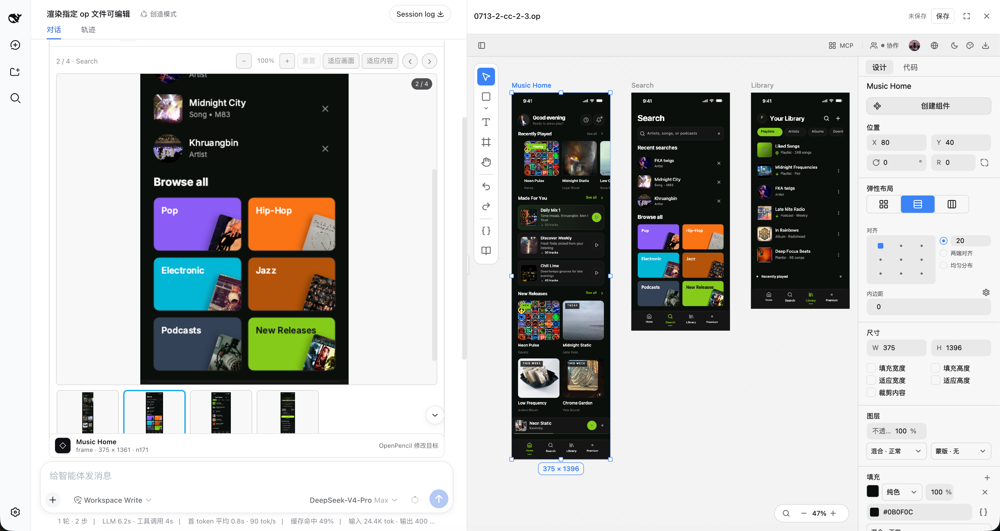

<p align="center">
  
</p>

<h1 align="center">DSH OpenPencil</h1>

<p align="center">
  <strong>Plugin DeepSeek Harness dành cho OpenPencil — xem trước, kiểm tra và chỉnh sửa các tài liệu <code>.op</code> thực ngay trong một cuộc hội thoại.</strong><br />
  <sub>Xem trước Đa khung Chính xác &bull; Canvas Tương tác &bull; Trình biên tập Quản lý &bull; Công cụ Thiết kế dành riêng cho Agent</sub>
</p>

<p align="center">
  <sub>npm: <a href="https://www.npmjs.com/package/@zseven-w/dsh-openpencil"><code>@zseven-w/dsh-openpencil</code></a> · Bản phát hành plugin hiện tại: <code>0.1.0-rc.7</code> · Đã kiểm thử đến DSH <code>0.1.1-rc.2</code></sub>
</p>

<p align="center">
  <a href="./README.md">English</a> · <a href="./README.zh.md">简体中文</a> · <a href="./README.zh-TW.md">繁體中文</a> · <a href="./README.ja.md">日本語</a> · <a href="./README.ko.md">한국어</a> · <a href="./README.fr.md">Français</a> · <a href="./README.es.md">Español</a> · <a href="./README.de.md">Deutsch</a> · <a href="./README.pt.md">Português</a> · <a href="./README.ru.md">Русский</a> · <a href="./README.hi.md">हिन्दी</a> · <a href="./README.tr.md">Türkçe</a> · <a href="./README.th.md">ไทย</a> · <a href="./README.vi.md"><b>Tiếng Việt</b></a> · <a href="./README.id.md">Bahasa Indonesia</a>
</p>

<p align="center">
  <a href="https://www.npmjs.com/package/@zseven-w/dsh-openpencil"></a>
  <a href="https://github.com/ZSeven-W/openpencil/actions/workflows/dsh-check.yml"></a>
  <a href="https://github.com/ZSeven-W/openpencil/stargazers"></a>
  <a href="https://github.com/ZSeven-W/openpencil/blob/main/LICENSE"></a>
  <a href="https://discord.gg/h9Fmyy6pVh"></a>
</p>

<br />

<p align="center">
  
</p>
<p align="center"><sub>Xem trước <code>.op</code> đa khung chính xác với canvas tương tác và khu làm việc trình biên tập quản lý</sub></p>

## Vì sao chọn DSH OpenPencil

DSH OpenPencil kết nối [DeepSeek Harness](https://github.com/deepseek-ai/DSH) với [OpenPencil](https://github.com/ZSeven-W/openpencil) để Agent điều khiển một canvas thiết kế thực, có thể chỉnh sửa và tương tác, thay vì trả về một hình ảnh được tạo sẵn.

<table>
<tr>
<td width="50%">

### 🖼️ Xem trước Đa khung Chính xác

Trình xuất headless của OpenPencil được cài đặt sẽ kết xuất các bản xem trước trung thành với thiết kế: khung cấp cao nhất đầu tiên dưới dạng một PNG lớn an toàn để phát lại, cùng một dải ảnh thu nhỏ cuộn ngang, chọn bằng cách nhấp chuột và điều hướng trước/sau cho các tài liệu nhiều khung.

</td>
<td width="50%">

### 🗺️ Canvas Tương tác

"Mở canvas tương tác" tải trễ SDK Web OpenPencil chỉ đọc với các thao tác pan, zoom và vừa khung — kiểm tra mọi trang, nút lồng nhau hoặc trang không hoạt động mà không cần rời khỏi cuộc hội thoại.

</td>
</tr>
<tr>
<td width="50%">

### ✏️ Trình biên tập Quản lý

Với `editable: true`, hành động chỉnh sửa sẽ mở trình biên tập OpenPencil được quản lý — chọn đối tượng, lớp, thuộc tính, công cụ vẽ, hoàn tác/làm lại và ngữ nghĩa lưu tường minh — trong một khu làm việc bên phải có thể thay đổi kích thước kèm tùy chọn toàn màn hình.

</td>
<td width="50%">

### 🤖 Công cụ Thiết kế dành riêng cho Agent

Năm công cụ thao tác canvas trực tiếp cùng sáu công cụ `openpencil_pipeline_*` cho phép Agent tạo, kiểm tra, tinh chỉnh, công bố, sửa đổi và đọc một canvas thực qua các runtime OpenPencil được quản lý.

</td>
</tr>
<tr>
<td width="50%">

### 🔐 Cấp quyền được Kiểm soát bằng Capability

Các quyền truy cập hình ảnh và tài liệu là các capability được ký và ràng buộc băm. Siêu dữ liệu trình duyệt không bao giờ lộ một đường dẫn máy chủ tùy ý, và các capability xem trước/biên tập được ký không bao giờ đi vào kết quả công cụ chuẩn hoặc ngữ cảnh mô hình.

</td>
<td width="50%">

### ⚡ An toàn Giao dịch

Tài liệu trong pipeline đầy đủ vẫn là bản nháp riêng tư, chưa công bố cho đến khi vượt qua mọi cổng chất lượng native và DSH. Việc công bố không ghi đè đường dẫn hiện có; thao tác hủy hoặc batch thất bại không để lại đích rỗng.

</td>
</tr>
<tr>
<td width="50%">

### 🌍 Tuân theo Diện mạo & Cảm nhận của DSH

Thẻ công cụ và trình biên tập quản lý tuân theo ngôn ngữ Trung/Anh và chủ đề sáng/tối của DSH mà không cần tải lại phiên chỉnh sửa.

</td>
<td width="50%">

### 🎯 Một Quy trình Hoàn chỉnh

"Yêu cầu → bản nháp riêng tư → các batch ngữ nghĩa → bản xem trước live cho người dùng → xác thực tất định về cấu trúc/layout/chất lượng → công bố nguyên tử với tính toàn vẹn của PNG cuối" — một vòng khép kín trong DSH.

</td>
</tr>
</table>

## Cài đặt vào DSH

DSH là một gói riêng. Cài một lần nếu bạn chưa có:

```sh
npm install -g @deepseek-ai/dsh@latest
```

Sau đó thêm plugin vào một profile và khởi động ứng dụng web:

```sh
dsh plugin --profile web add @zseven-w/dsh-openpencil@next
dsh web
```

Để phát triển cục bộ, hãy build checkout này, liên kết đường dẫn tuyệt đối của nó vào profile Web, rồi khởi động lại DSH hoàn toàn:

```sh
pnpm run build
dsh plugin --profile web add link:/absolute/path/to/dsh-openpencil
dsh web
```

Phụ thuộc `link:` làm cho các bản build lại sau đó hiển thị trực tiếp từ checkout này. Tuy nhiên, DSH phải được khởi động lại hoàn toàn sau khi thay thế phụ thuộc profile vì profile Web đi kèm không hot-reload các bundle host theo mặc định.

Không muốn cài DSH toàn cục? Chạy đúng hai bước đó qua `pnpm dlx`:

```sh
pnpm dlx --package=@deepseek-ai/dsh@latest dsh plugin --profile web add @zseven-w/dsh-openpencil@next
pnpm dlx --package=@deepseek-ai/dsh@latest dsh web
```

> Plugin OpenPencil là công khai và không yêu cầu token npm. Nếu bản prerelease của DSH tự nó yêu cầu xác thực registry, hãy giữ thông tin xác thực đó trong một cấu hình npm cấp người dùng hoặc tạm thời bên ngoài thư mục checkout. Kho lưu trữ này cố ý không chứa bất kỳ thông tin xác thực registry nào.

## Công cụ Thiết kế

Lựa chọn tùy chọn theo `openpencil_style_plan` → `openpencil_style_confirm` → `openpencil_pipeline_begin`, giữ brief gốc và truyền `style_selection`. Danh mục và chọn chính xác không cần đề xuất; nhà cung cấp mặc định tắt. Handoff hỗ trợ script, không hỗ trợ app-agent hay commerce. Tạo app-agent thông thường vẫn dùng được.

| Công cụ | Chức năng |
| --- | --- |
| `openpencil_new` | Lối nhanh tương thích cho tác vụ đơn giản: chạy một script QuickJS `batch_design` giao dịch, chỉ công bố nếu đích chưa tồn tại và trả về phần trình bày có thể chỉnh sửa. Hãy ưu tiên pipeline đầy đủ cho thiết kế production. |
| `openpencil_pipeline_begin` | Bắt đầu bản nháp riêng của phiên, tạo nội bộ root duy nhất, trả về hợp đồng canvas/build gọn khớp runtime và mở ngay chính bản nháp live đó trong thanh bên; `.op` đích vẫn chưa công bố. |
| `openpencil_pipeline_context` | Chỉ tải một chi tiết cụ thể về hướng dẫn, style, theme hoặc UI kit thực sự thiếu trong hợp đồng begin; đây không phải bước khởi động cố định. |
| `openpencil_pipeline_batch` | Chạy tối đa hai script tạo native trực tiếp `I(...)`/`K(...)`: viewport đầu tiên bị giới hạn bởi `begin.next`, rồi mọi vùng còn lại trong batch thứ hai và cuối. Mỗi giao dịch thành công chỉ thử hiển thị PNG chính xác cho người dùng. |
| `openpencil_pipeline_inspect` | Chỉ cung cấp chẩn đoán thủ công khi người dùng yêu cầu rõ ràng; quá trình tạo thông thường không dùng nó làm bản xem trước hay bước xem xét trực quan của mô hình. |
| `openpencil_pipeline_finish` | Trong một lần gọi lành mạnh, hoàn tất và xác thực bản nháp, tự động render bản xem trước PNG chính xác của root cuối và công bố nguyên tử bằng `createIfAbsent`. Chỉ kết quả `needs_correction`, `canContinue: true`, có `repairTargets` đầy đủ không rỗng và `omitted: 0` mới cho phép một lần sửa U-only và một lần finish cuối; mọi kết quả chưa công bố khác đều là terminal. |
| `openpencil_pipeline_abort` | Loại bỏ bản nháp chưa công bố mà không tạo tệp đích. |
| `openpencil_create` | Áp dụng một chương trình `batch_design` giao dịch để tạo hoặc tái cấu trúc các nút trên một canvas trực tiếp hiện có. |
| `openpencil_edit` | Sửa đổi một nút tường minh hoặc nút duy nhất do người dùng chọn. |
| `openpencil_render` | Tạo một ảnh chụp `.op` bất biến, định địa chỉ theo nội dung và kết xuất mọi khung cấp cao nhất trên trang đang hoạt động — `scale` và `editable` tùy chọn. |
| `openpencil_selection` | Đọc chính xác các nút đang được chọn trong canvas của trình biên tập trực tiếp. |

## Quy trình Thiết kế của Agent

Với một yêu cầu ngắn thông thường, hãy gọi ngay `openpencil_pipeline_begin` và đi theo lối nhanh cố định: batch JS trực tiếp đầu tiên bị giới hạn bởi `begin.next` → batch JS trực tiếp thứ hai và cuối chứa mọi vùng còn lại → một lần gọi `openpencil_pipeline_finish`. Begin tạo root duy nhất và mở ngay canvas live riêng trong thanh bên; đường dẫn workspace được yêu cầu vẫn chưa tồn tại cho đến khi công bố nguyên tử. Sau mỗi begin hoặc batch thành công, hãy thực hiện ngay lời gọi bắt buộc tiếp theo mà không tường thuật, lập kế hoạch, so sánh, kiểm tra hay gọi công cụ không liên quan. Mặc định toàn bộ thiết kế chỉ dùng đúng một ảnh; mỗi frame Hero/Product/Art/Media có đúng một hình ảnh chính, không bao giờ kết hợp ảnh với icon giữ chỗ.

Sau mỗi batch được commit thành công, công cụ chỉ thử trình bày bản xem trước PNG chính xác cho người dùng. Ngay khi lời gọi trả về, hãy làm theo `next` ngay lập tức; đừng chờ mô hình tự kiểm tra trực quan. Nếu `next` báo `previewUnavailable`, script đã được commit trên canvas live: không chạy lại batch và không gọi `openpencil_pipeline_inspect` hay `read_image`. `openpencil_pipeline_inspect` chỉ dành cho chẩn đoán mà người dùng yêu cầu rõ ràng.

Finish chạy các kiểm tra tất định native về finalization, lint, độ tương phản và layout cùng các cổng chất lượng cứng của DSH. Một lần gọi lành mạnh render PNG chính xác của root cuối và công bố trong cùng bước. Chỉ cho phép sửa khi kết quả đồng thời có `stage: "needs_correction"`, `canContinue: true`, `repairTargets` đầy đủ không rỗng với `omitted: 0`, và mỗi target có `operation: "U"`, `nodeId` chính xác không rỗng cùng `patch` không rỗng. Áp dụng mọi target cùng lúc trong đúng một batch U-only, rồi gọi finish đúng một lần cuối mà không tường thuật. Mọi kết quả chưa công bố khác, error hoặc `canContinue: false` đều là terminal: chỉ báo cáo một lần và không retry, inspect, đọc image/context, abort hay bắt đầu draft thay thế. Khi `published: true`, PNG cuối và trình biên tập live đã được đính kèm: trả kết quả và kết thúc ngay. Cổng thất bại hoặc `openpencil_pipeline_abort` giữ đích không tồn tại. Quyền chỉnh sửa theo tài liệu chỉ tự mở thanh bên khi thanh bên đang trống và luôn giữ **Sửa canvas** để chuyển đổi rõ ràng.

Trong cùng dịch vụ DSH đang chạy, sau khi đổi trình duyệt hoặc tải lại, một publication bền vững được phân tích nghiêm ngặt từ `openpencil_new` hoặc `openpencil_pipeline_finish` có thể được khôi phục thành PNG chính xác cùng hành động **Sửa canvas** rõ ràng. Thẻ lịch sử không bao giờ tự mở thanh bên; người dùng phải bấm hành động đó. `openpencil_render` lịch sử thông thường vẫn chỉ đọc, và kết nối không phải loopback không bao giờ nhận quyền biên tập.

Skill `openpencil-design` đi kèm vẫn là tài liệu tham khảo mỏng, tùy chọn; quá trình tạo thông thường bắt đầu trực tiếp từ hợp đồng begin gọn và đầy đủ. Schema công cụ native hiện tại là nguồn thẩm quyền, còn runtime được quản lý không phụ thuộc vào binary desktop. `openpencil_new` vẫn là lối nhanh một batch tương thích.

Chỉ dùng `openpencil_create` và `openpencil_edit` cho một canvas trực tiếp hiện có. Các chỉnh sửa của chúng vẫn chưa được lưu cho đến khi hành động Lưu của trình biên tập được thực hiện.

## Tài nguyên Web Viewer

DSH chỉ phục vụ `client.js` cho một client plugin, vì vậy SDK ESM của OpenPencil, WASM của nó và CanvasKit được đưa vào làm các tài nguyên cùng nguồn gốc tường minh:

```sh
pnpm run sync:viewer-assets
```

Lệnh sync mặc định sử dụng thư mục gốc monorepo OpenPencil (`../..`) và dự phòng sang checkout `../openpencil` liền kề. Ghi đè nó bằng `OPENPENCIL_ROOT` hoặc `--openpencil-root`. Một thư mục tài nguyên đã được dựng sẵn hoàn chỉnh có thể được chọn bằng `DSHPLUGIN_OPENPENCIL_VIEWER_SOURCE`. Việc tra cứu lúc chạy có thể được ghi đè bằng `DSHPLUGIN_OPENPENCIL_VIEWER_ASSET_DIR`.

Tài nguyên viewer chỉ được tải trễ sau khi người dùng mở canvas. Nếu chúng vắng mặt hoặc không hợp lệ, bản xem trước PNG vẫn khả dụng và không có nút canvas nào được quảng bá.

## Trình biên tập Quản lý

Các phiên có thể chỉnh sửa sử dụng web host được quản lý của OpenPencil — cùng kiến trúc được `op-vscode` sử dụng. Plugin chỉ khởi động host sau một hành động người dùng được ủy quyền, giữ token daemon trong bộ nhớ, xác thực nguồn và origin của iframe, và đóng tiến trình khi phiên trình biên tập kết thúc. Bề mặt trình biên tập được chọn dần: chi tiết Tool gốc khi host khai báo ranh giới đó, nếu không thì là khu làm việc bên phải của plugin với các điều khiển thay đổi kích thước và toàn màn hình.

Quá trình khởi động dùng listening handshake an toàn với mount chậm: các probe sẵn sàng chỉ bắt đầu sau khi host đi kèm công bố địa chỉ đã bind. Không cần cài OpenPencil bản desktop.

Các bản cài đặt đã phát hành chọn gói phù hợp với OS/CPU hiện tại trong sáu gói nền tảng native: `darwin-arm64`, `darwin-x64`, `linux-arm64`, `linux-x64`, `win32-arm64` và `win32-x64`; cả hai gói Linux đều nhắm tới glibc. Gói gốc khai báo chúng là `optionalDependencies` với phiên bản chính xác để trình quản lý gói chọn đúng biến thể (ví dụ `@zseven-w/dsh-openpencil-darwin-arm64`). Gói đó phân phối `op-host-web-server`, web bundle của trình biên tập và CanvasKit tương thích với nhau như một runtime duy nhất. Vì vậy, trình biên tập được quản lý không phụ thuộc vào `/Applications/OpenPencil.app`, `openpencil-desktop` trong `PATH` hay một checkout mã nguồn OpenPencil.

Nếu DSH tải lại hoặc gỡ plugin trong khi canvas đang có thay đổi chưa lưu, host giữ một bản nháp phục hồi cục bộ không thể đọc được trong tối đa bảy ngày. Việc mở lại cùng nguồn đó sẽ hỏi trước khi khôi phục nó vào canvas trực tiếp; phục hồi không bao giờ ghi đè tệp `.op` cho đến khi người dùng lưu một cách tường minh.

Các gói chính thức cho sáu nền tảng được chèn endpoint bootstrap cộng tác dành cho Trung Quốc và Toàn cầu trong build release được bảo vệ; các giá trị đã chèn được xác thực trước khi phát hành. Bản tự build cục bộ không có bước chèn này có thể ghi đè bootstrap trước khi khởi động DSH bằng `OPENPENCIL_COLLAB_BOOTSTRAP_URL=https://<your-host>/api/v1/collaboration/bootstrap`; giá trị phải dùng `https` và đường dẫn phải chính xác là `/api/v1/collaboration/bootstrap`.

Để đồng bộ canvas giữa các thiết bị, cả runtime native PC/DSH và ứng dụng di động phải được cập nhật lên cùng một dòng phát hành OpenPencil có bản sửa hàng đợi cộng tác hiện tại. Khi dùng ứng dụng di động cũ với runtime PC mới hơn, con trỏ từ xa vẫn có thể xuất hiện nhưng các commit canvas không được nhận.

Khi phát triển từ kho lưu trữ này, trước khi khởi động DSH hãy build Web bundle của trình biên tập, tiếp theo build host native, rồi stage runtime tương thích đó.

`pnpm run build:editor-web` chạy WASM bundle gate được OpenPencil hỗ trợ chính thức. Bước này cần Bash, Cargo/Rust với target `wasm32-unknown-unknown`, CLI `wasm-bindgen`, `wasm-opt` của Binaryen, Node.js và `gzip`; CanvasKit không cần EMSDK. Web build không sử dụng các biến build bootstrap cộng tác. Trước `pnpm run build:editor-runtime`, phải đặt đồng thời `OPENPENCIL_BUILD_COLLAB_BOOTSTRAP_URL_CN` và `OPENPENCIL_BUILD_COLLAB_BOOTSTRAP_URL_GLOBAL`. Chúng chỉ được dùng cho native Cargo build, bước này sẽ fail closed nếu thiếu một biến. Sau khi cả hai build thành công, hãy stage runtime bằng lệnh cuối cùng.

```sh
pnpm run build:editor-web
pnpm run build:editor-runtime
pnpm run stage:editor-runtime
```

Các ghi đè runtime tường minh chỉ được chấp nhận dưới dạng một bộ đầy đủ và tương thích:

- `DSHPLUGIN_OPENPENCIL_EDITOR_BINARY` cho `op-host-web-server`;
- `DSHPLUGIN_OPENPENCIL_EDITOR_WEB_BUNDLE_DIR` cho web bundle trình biên tập đã được build;
- `DSHPLUGIN_OPENPENCIL_EDITOR_CANVASKIT_DIR` cho các tài nguyên CanvasKit.

Chỉ cung cấp một phần của bộ này là cấu hình không hợp lệ; plugin không kết hợp các đường dẫn tùy chỉnh với tài nguyên runtime được đóng gói.

Việc lưu sử dụng một băm nguồn lạc quan, một thay thế nguyên tử và một capability kế thừa. Nếu nguồn thay đổi bên ngoài trình biên tập, plugin báo cáo một xung đột thay vì ghi đè nó.

## Siêu dữ liệu Kết quả

Kết quả hiển thị cho mô hình vẫn là JSON thuần. `presentationMeta.$dshOpenPencil` chỉ dành cho trình duyệt mang các quyền truy cập bổ sung cho:

- `image`: đường dẫn PNG, URL xem trước/tải xuống và width/height thực;
- `frames`: mọi khung cấp cao nhất được kết xuất chính xác theo thứ tự trang đang hoạt động, bao gồm id/tên/chỉ mục nút và các URL PNG đã ký;
- `document`: đường dẫn hành động nguồn cùng URL ảnh chụp bất biến, số byte và SHA-256;
- `viewer`: các URL SDK/WASM/CanvasKit theo phiên bản khi route tài nguyên được gắn;
- `editor`: các capability khởi chạy/làm mới có phạm vi khi `editable: true` được ủy quyền.

Kết quả cũng ghi lại `renderer`, `rendererBinary`, `fidelity` và mọi cảnh báo. Các thông điệp schema-v1 chỉ có PNG hiện có vẫn có thể được kết xuất.

DSH `0.1.1-rc.2` không lưu trữ siêu dữ liệu trình bày của trình duyệt cho các công cụ nằm lồng bên dưới PTC/Code Mode. Plugin khôi phục phép chiếu UI-only đó qua một endpoint same-origin, session-bound: trình duyệt chỉ gửi session id, call id và SHA-256 bất biến của tài liệu, trong khi host phân giải kết quả có thẩm quyền từ nhật ký phiên DSH bền vững và chỉ sử dụng một marker trong tiến trình có thời hạn ngắn để ủy quyền cho việc chỉnh sửa trực tiếp gần đây. Các capability xem trước/biên tập được ký không bao giờ đi vào kết quả công cụ chuẩn hoặc ngữ cảnh mô hình. Lịch sử bền vững của `openpencil_render` thông thường vẫn chỉ đọc. Publication bền vững được phân tích nghiêm ngặt từ `openpencil_new` hoặc `openpencil_pipeline_finish` chỉ có thể nhận quyền biên tập qua loopback và sau cú nhấp rõ ràng của người dùng; tự động mở thanh bên chỉ dành cho kết quả trực tiếp gần đây, đáng tin cậy.

Đối với phát lại có giới hạn, việc phục hồi siêu dữ liệu lồng nhau chấp nhận tối đa 128 khung cấp cao nhất; các kết quả Code Mode lớn hơn vẫn khả dụng qua dự phòng JSON chuẩn của chúng.

## Giới hạn Hiện tại

- Các chỉnh sửa tiếp theo trên một canvas hiện có yêu cầu một trình biên tập quản lý đã được mở. Thay đổi vẫn chưa được lưu cho đến khi người dùng gọi hành động Lưu của nó.
- Canvas của Web SDK nhẹ chỉ đọc; chỉnh sửa đầy đủ sử dụng bề mặt trình biên tập quản lý riêng. Trên DSH `0.1.1-rc.2`, plugin sử dụng khu làm việc bên phải có thể thay đổi kích thước kèm tùy chọn toàn màn hình.
- Thư viện ảnh chính xác bao phủ các khung cấp cao nhất trên trang đang hoạt động; canvas tương tác vẫn là cách để kiểm tra các trang không hoạt động và các nút lồng nhau.
- Các bộ nhớ đệm kết xuất và ảnh chụp vẫn cần một chính sách lưu giữ ở cấp sản phẩm.

## Cấu trúc Dự án

```text
packages/op-dsh/
├── src/                       Plugin sources (TypeScript)
│   ├── index.ts               Host plugin entry — Cordis service, tools, assets
│   ├── tool.ts / design-tools.ts / new-tool.ts   Host-side design tools
│   ├── renderer.ts            Exact OpenPencil renderer + Jian fallback
│   ├── editor-host.ts / editor-recovery.ts       Managed editor lifecycle + drafts
│   ├── viewer-assets.ts       Web SDK / WASM / CanvasKit asset staging
│   ├── mcp-client.ts          OpenPencil MCP connection
│   └── client/                Browser client — React workbench, gallery, selection dock
├── lib/                       Compiled output (published to npm)
├── scripts/                   Build helpers — viewer asset sync, client build, host tests
├── tests/                     Node test suites (client, host API, MCP, viewer assets)
├── docs/images/               Documentation screenshots
├── cordis.patch.yml           DSH bundle patch that mounts the plugin
├── tsconfig.json              Host / Node TypeScript config
└── tsconfig.client.json       Browser client TypeScript config
```

## Xây dựng và Kiểm chứng

```sh
pnpm run sync:viewer-assets
pnpm run build
pnpm run test:viewer-assets
pnpm run test:client
pnpm run test:host /absolute/path/to/design.op 375 1091
```

Việc xây dựng yêu cầu Node 24.11 trở lên và pnpm. Các gói host/client của DSH là các peer dependency do hồ sơ DSH mục tiêu cung cấp. Các công cụ xây dựng được phân giải từ dev dependencies cục bộ, thư mục checkout DSH đã liên kết đang hoạt động hoặc một bundle nguồn DSH đã cài đặt; `DSH_SOURCE_ROOT` có thể chọn một checkout nguồn một cách tường minh. Lockfile cố định các công cụ xây dựng công khai độc lập khi môi trường đó được cấp phát riêng biệt.

Đối với một bản prerelease riêng tư của DSH, hãy giữ thông tin xác thực npm được cấp bên ngoài kho lưu trữ này (ví dụ trong một `.npmrc` cấp người dùng hoặc tạm thời) và chạy trực tiếp phiên bản được yêu cầu:

```sh
pnpm dlx --package=@deepseek-ai/dsh@latest dsh web
```

Không bao giờ commit `.npmrc`, `NPM_TOKEN` hoặc thông tin xác thực registry được sao chép. Kho lưu trữ này mặc định bỏ qua cấu hình npm cục bộ.

`test:host` thực hiện một kết xuất chính xác thực, xác thực hình học PNG IHDR và SHA-256, kiểm tra các capability hình ảnh/tài liệu bất biến qua HTTP và xác nhận rằng tài nguyên viewer có thể được cấp quyền. Các kích thước mong đợi phụ thuộc vào fixture.

## Hệ sinh thái

DSH OpenPencil là plugin DeepSeek Harness dành cho **[OpenPencil](https://github.com/ZSeven-W/openpencil)** — công cụ thiết kế vector AI-native mã nguồn mở đầu tiên trên thế giới — và là một phần của gia đình **[ZSeven-W](https://github.com/ZSeven-W)** gồm các công cụ AI-native thuần Rust.

| Dự án | Mô tả |
| ------- | ---------- |
| **[OpenPencil](https://github.com/ZSeven-W/openpencil)** | Công cụ thiết kế mà plugin này điều khiển — tạo canvas từ lời nhắc, các nhóm agent đồng thời, tệp `.op` thiết kế dạng mã và một máy chủ MCP tích hợp. Các bản xem trước chính xác, canvas tương tác và trình biên tập quản lý ở đây đều do chính OpenPencil cung cấp sức mạnh. |
| **[agent-rs](https://github.com/ZSeven-W/agent-rs)** | Một runtime async thuần Rust để vận hành các agent LLM — đa nhà cung cấp, hỗ trợ công cụ đầu cuối, quyền có cấu trúc, MCP thực, không một chút `unsafe` nào. Cung cấp sức mạnh cho runtime agent tích hợp của OpenPencil. |
| **[jian](https://github.com/ZSeven-W/jian)** | Khung giao diện UI thuần Rust, GPU-Skia — widgets, bố cục, sự kiện và hot reload trong một stack duy nhất. Là khung UI của OpenPencil và nguồn gốc của trình kết xuất dự phòng của plugin này. |
| **[Zode](https://github.com/ZSeven-W/zode)** | Trợ lý lập trình AI-native mã nguồn mở cho terminal của bạn — đọc mã của bạn, chạy lệnh và điều khiển OpenPencil qua MCP. |
| **[noema](https://github.com/ZSeven-W/noema)** | Hệ thống bộ nhớ local-first, phi vector cho các agent lập trình — bộ nhớ bền vững dưới dạng các tệp có thể kiểm tra, hoạt động trên nhiều runtime. |
| **[openpencil-skill](https://github.com/ZSeven-W/openpencil-skill)** | Plugin skill LLM dạy các agent AI cách thiết kế bằng `op` — một người bạn đồng hành của plugin DSH này. |

Các plugin DSH cùng họ:

- [DSH Android](https://github.com/ZSeven-W/dsh-android) — trình giả lập Android hoặc thiết bị cắm USB trực tiếp ngay trong hội thoại, điều khiển hoàn toàn qua adb
- [DSH Crew](https://github.com/ZSeven-W/dsh-crew) — giao việc cho agent DSH từ Claude Code / Codex
- [DSH iOS](https://github.com/ZSeven-W/dsh-ios) — một iOS Simulator sống động — và iPhone kết nối USB — ngay trong hội thoại
- [DSH Noema](https://github.com/ZSeven-W/dsh-noema) — bộ nhớ dài hạn cho DSH

## Đóng góp

Rất hoan nghênh các đóng góp! Hãy fork và clone, tạo một nhánh, chạy `pnpm run build` và các bộ kiểm thử, commit theo [Conventional Commits](https://www.conventionalcommits.org/) và mở một PR tới nhánh `main`.

## Cộng đồng

<a href="https://discord.gg/h9Fmyy6pVh">
  
  <strong> Tham gia Discord của chúng tôi</strong>
</a>
— Đặt câu hỏi, chia sẻ thiết kế, đề xuất tính năng.

**Cộng đồng được công nhận: [LINUX DO](https://linux.do/)**

## Giấy phép

[MIT](./LICENSE) — Bản quyền (c) 2026 ZSeven-W

Các thành phần của bên thứ ba được liệt kê trong [THIRD_PARTY_NOTICES.md](./THIRD_PARTY_NOTICES.md).
